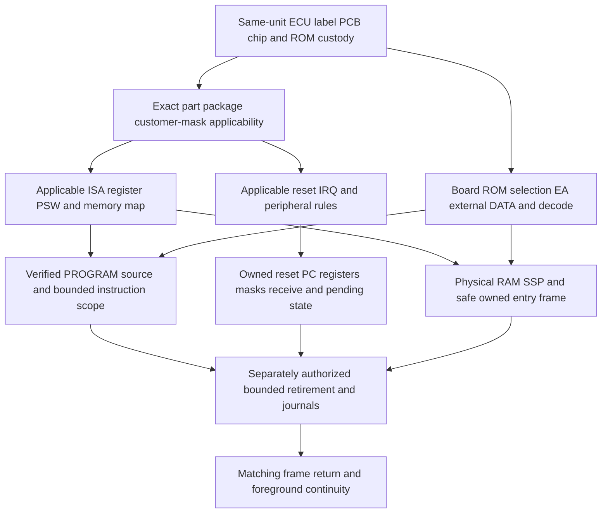

# M2cl: actual ECU silicon identity and peripheral applicability

**ECU_SILICON_IDENTITY_UNRESOLVED / EXECUTION_BLOCKED.**

M2cl separates the authenticated software image, documented standard OKI parts,
and a physical ECU. No acquired evidence closes the same-unit link between all
three. Named standard-device properties and useful candidate differences are
established; the actual ECU part, PCB, MCU package and mask remain unknown.
FirmwareReady=false. New CPU/ROM/IRQ/RTI executions and hardware experiments=0.

The accepted base is M2ck `081c9c49f2cda648a6be6c63d87e58c4417bf519`.
The research branch is `codex/p28-word0196-ecu-silicon-applicability-m2cl`.
The final identity is the commit containing this document and the reviewed
`research/p28-word0196/ecu_silicon_applicability/` package. Exact push, CI and
working-tree results belong to their completed delivery receipts and final
report; this source document does not claim prospective QA or a self-referential
final commit hash.

## What is and is not identified

| Object | Established | Not established |
|---|---|---|
| Studied software source | One admitted 32768-byte payload with authenticated archive transport identity and retained source fence | Factory originality, donor ECU identity or physical extraction custody |
| Historical catalog label | P28-A01 is a recorded community catalog association and a search locator | Observed full OEM part number, actual case label or PCB revision |
| Actual MCU | The reviewed image has bounded instruction/source relationships compatible with the reviewed OKI architecture | Readable same-board top marking, exact part/customer suffix/mask/package/revision |
| Actual memory/peripherals | Conditional mappings can be compared with standard parts | Actual EA strap, external decode, internal versus external storage, peripheral revision and owners |
| Published reference board | A newly acquired third-party P28-A51 reverse-engineering drawing has identifiable sheet labels | That the drawing depicts the studied donor, or that its optional components were present in it |

The local archive's original provenance record labels the payload's origin
unknown. A catalog entry, file/profile name, ROM length, decoded instruction,
checksum residue or repeated mirror cannot substitute for a donor/extraction
chain. No same-donor ECU/PCB/chip photograph or authenticated hardware record was
found in the reviewed compact dossiers and offline index selectors. This is a
bounded finding, not a claim that such evidence cannot exist elsewhere.

## Primary manufacturer sources

| Source | Exact identity | Scope |
|---|---|---|
| [Japanese specification](https://datasheet.datasheetarchive.com/originals/library/Datasheets-DAV1/DSADA0015905.pdf) | OKI `J2E1027-27-Y3`, January1998, previous November1996; 602102 bytes; SHA-256 `9da5f4c364fb8aed21c783bc5ad7b1e114c4b8773c7a00b9a7373c261112bf7a` | Four named standard parts, package lists, SFR tables, memory maps and electrical conditions; not actual ECU/mask identification |
| [English specification](https://files.boostednw.com/HONDA/66207.pdf) | OKI `E2E1027-27-Y4`, January1998, previous November1996; retained 589158-byte source; SHA-256 `247913724eb291e20c869d42ba40363268fba415ab787b7c843e2a094533f0fe` | Same named standard family; source-specific labels retained |
| [English mirror](https://downloads.laboratoryb.org/insight/documents/OKI/MSM66201.pdf) | Known Y4 edition in another 583437-byte container; SHA-256 `fe18068dc496a03f5b6bdefe5818741e572cb7626acfb3d1df427547f8b3264b` | A different container, not another independent manufacturer revision |
| [Instruction Manual](https://mycomputerninja.com/~jon/www.pgmfi.org/twiki/pub/Library/66kAssemblerDocs/Oki_66201_Instruction_Manual.pdf) | MSM66201, First Edition September1991; 4563117 bytes; SHA-256 `f6e423ac0bd15378754e30c35ed426415ec219e360c68e817ab451df72142271` | Standard instruction/register rules; printed1-5 expressly qualifies the vector table and customer I/O variants |
| [Incomplete User body](https://mycomputerninja.com/~jon/www.pgmfi.org/twiki/pub/Library/66kAssemblerDocs/66207usersmanual_incomplete.zip) | Retained MSM66201/207 body; 16203609 bytes; SHA-256 `f061cb5bcbd1804699fb60b543c425646fbb15b939c9bc51b24edbb4da4c6ddf` | No authenticated cover/edition; seven known CRC failures and missing pages remain; selected intact pages support qualified facts only |

Japanese PDF page indices1..30 equal printed1/30..30/30. Full relevant package,
pin, register, SFR and memory-map pages were visually reviewed; complete
User24..31 and relevant Instruction Manual pages were checked independently.
The Japanese container's pre-existing encryption/font/parser qualifications are
retained, with no repair or claim of perfect PDF conformance. A fresh Poppler
render without available Japanese fonts was used only together with the retained
font-correct full-page images and enlarged details, not to invent missing text.
Printed edition identification is not an official cryptographic authenticity
chain or proof of a particular produced mask. No new manufacturer edition was
acquired merely by inspecting these existing files again.

## Four candidates remain distinct

The standard-device inventory below is source-qualified, not a ranking of the
actual ECU. Japanese pages1-3/17 and English pages1-3/17 are the relevant source
boundaries. PROM counterparts are explicitly paired on page1; their nominal
capacities follow that paired-device description, not a newly verified OTP
programming-mode admission.

| Candidate | Named core | Nominal internal program | Total internal DATA RAM | Listed package forms |
|---|---|---:|---:|---|
| MSM66201 | nX-8/200 | 16KiB ROM | 512 bytes | SS64 shrinkDIP; GS-BK64 QFP; JS68 QFJ/PLCC |
| MSM66207 | nX-8/200 | 32KiB ROM | 1024 bytes | SS64 shrinkDIP; GS-BK64 QFP; JS68 QFJ/PLCC |
| MSM66P201 | OTP counterpart of MSM66201 | Nominal16KiB one-time PROM counterpart | Nominal512-byte counterpart | SS64 shrinkDIP; JS68 QFJ/PLCC |
| MSM66P207 | OTP counterpart of MSM66207 | Nominal32KiB one-time PROM counterpart | Nominal1024-byte counterpart | SS64 shrinkDIP; JS68 QFJ/PLCC |

Page2 lists the 64-pin QFP only for MSM66201/MSM66207, and the Japanese note
expressly repeats that restriction. It must not be silently added to the OTP
parts. The separate MSM66G207VS ceramic piggyback is listed for engineering
samples only. The `xxx` suffix is a code number; neither the package list nor
an assembly-compatible core makes it an authenticated Honda alias, peripheral
mask revision or arbitrary interchangeability rule.

The family inventory includes four16-bit timers, one synchronous/UART serial
channel with baud-rate generators, two16-bit PWM channels, four transition
detectors, an eight-channel10-bit ADC, watchdog, one nonmaskable external input
and16 internal/two external maskable factors. These resources do not prove that
an unidentified customer implementation has the same wiring, factors or revision.

## Memory boundaries and discriminating addresses

PROGRAM and DATA are separate64KiB spaces. Under the standard internal-memory
map, the ranges are:

| Region | Standard201 family | Standard207 family |
|---|---|---|
| Internal PROGRAM | 0000..3FFF | 0000..7FFF |
| PROGRAM beyond normal internal range | 4000..FFFF external space | 8000..FFFF external space |
| SFR DATA | 0000..007F | 0000..007F |
| Total internal DATA RAM | **0080..027F** | **0080..047F** |
| Pointing-register RAM within that total | 0080..00BF | 0080..00BF |
| Other zero-page RAM within that total | 00C0..00FF | 00C0..00FF |
| Paged internal RAM portion | 0100..027F | 0100..047F |
| DATA beyond normal internal RAM | 0280..FFFF external space | 0480..FFFF external space |

The lower total-RAM boundary is0080, not0100:64-byte PR storage is included in
the advertised512/1024 bytes. Full Japanese17/30 and User26-27 corroborate these
boundaries. Earlier M2aw had confirmed the201 interval but retained the exact207
interval as unestablished from its then-reviewed pages; M2cl adds a direct full
map source relationship rather than rewriting that historical result.

DATA03F0..03F7 and a word at047E/F fit standard207 internal RAM. They lie outside
standard201 internal RAM, but in its external DATA region. Therefore their use
does not prove a207, rule out201 with external memory, establish a custom ASIC,
or provide a safe stack. Likewise PROGRAM54EA/54F0 exceed201 internal16KiB, but
external PROGRAM is documented. A32KiB file is not a measurement of on-chip ROM.

Page7 describes P0/AD0..7 and P1/A8..15; page8 describes ALE, PSEN for PROGRAM
reads, RD/WR for DATA and EA selecting external PROGRAM access when low. Pinout
pages4-6 distinguish packages. Actual board straps, bus latches, population,
decode, overlays/banking and external RAM remain unknown. The standard diagram
does not itself authorize the current Bus mapping or reveal a physical owner.

## Address-role applicability matrix

| Space/address | Confirmed bounded role | Applicability and remaining condition |
|---|---|---|
| PROGRAM000A | Retained payload vector target0213; standard RX-ready allocation | Source-qualified standard vector; actual customer vector/peripheral/delivery unknown |
| PROGRAM0213 | Static handler entry | Requires applicable silicon, pending/masks, legal entry and safe owned frame |
| PROGRAM0262 | LB reads DATA0055 into AL | Actual SRBUF generation/read unobserved; read-ACK unknown |
| PROGRAM0264 | CMPB compares r5 with2 | It does not compare the received F |
| PROGRAM0269 | STB AL to conditional localr3/DATA03F3 | No odd-F prerequisite; physical mapping and current write generation unknown |
| PROGRAM029C | RTI instruction site | Restored PC must be the matching saved foreground PC, not029C or host28AE |
| DATA03F0..03F7 | Local parser bank if retained LRB007E applies | Standard207 internal/201 external; actual RAM and bank owners unknown |
| DATA0054/0055/0056 | Standard SRCON/SRBUF/SRSTAT, page11 | Same SFR names/addresses do not prove actual peripheral revision or ACK behavior |
| DATA0018..001B | Standard IRQ/IE words, page10 | Distinct from PROGRAM vector words; actual pending/IE/MIE and polarity unknown |
| PROGRAM54EA | Static word IRQ clear | If completed, cuts the earlier request generation; concurrent set/clear order unknown |
| PROGRAM54F0 | Static IE writer | Actual reaching/history and current IE owner unobserved |
| PROGRAM3F14/3F28 | Alternative IE writers before shadow updates | Not one atomic native mask update; actual branch/mode/generations unknown |
| PROGRAM3E81 | Static mode/F8/IE/FA consistency checks | Static literals do not establish current shadows or masks |

The admitted payload's size and unchanged byte identity can be checked without
execution. Its zero-based file interval is[0000,8000), conditional on the reviewed
raw profile; that is not physical storage selection. Current byte-sum modulo256
residue0 is consistent with the inherited bounded M1f software checksum contract
(512 blocks of64 ascending byte reads), not a universal checksum algorithm,
separate stored checksum field, factory-authenticity test or physical boot proof.
No private ROM hash, name or payload is needed in public CI.

## PSW attribution correction and retained architecture limits

An enlarged fresh primary reread corrects one M2ck annotation: Japanese Y3
page9 lists **bit8 MIE**, not bit11. English Y4 page9 calls **bit8 MIP** and also
prints an odd repeated MIP label for user flags; its literal naming is retained.
User printed31 Figure3-5 labels **MIE at bit8** and marks bit11 nonexistent; the
prose lists3/6/7/10/11 as nonexistent/read-one bits. The old M2ck document and
receipt remain frozen. This is an explicit new source-attribution correction,
not an emulator change or retrospective rewrite.

The different summary labels alone do not demonstrate a physical peripheral
revision, and no such revision is selected. Standard CY15/ZF14/HC13/DD12 and
SCB2..0 have their own source fields. SCB selects one of eight pointing banks,
each with X1/X2/DP/USP; local r0 is the low byte and r1 the high byte of er0.
The reviewed LRB/page/bank relations remain architectural obligations, not
actual retained register values or a compiler ABI. Unknown physical SF remains
unknown. Numeric context or a read-one rule cannot fill a missing native owner.

Standard SFR tables give SSPFFFF, ACC0000, PSW readback C8/0C, undefined LRB and
WDT0011 write-only/reset00-stopped within the documented reset domain. They do
not establish the current reset event, safe SSP, WDT3C meaning or next-instruction
progress. Page8 identifies RES/RESOUT and OSC0/OSC1; page18 gives the recommended
standard VDD4.5..5.5V, fOSC0..10MHz at5V+/-10% and Ta-40..85C conditions. The
quoted400ns minimum instruction cycle at10MHz is not every instruction latency
or permission to convert retirement counters to physical elapsed time.

## Customer variants and the newly acquired board reference

Instruction Manual printed1-5 explicitly restricts its vector allocation table
to standard MSM66201. It permits customer-specific internal I/O while the CPU
remains the same, and says vector allocation can change, including excess
vectors after the VCAL area. That is direct manufacturer support for a possible
compatibility gap, not evidence that the studied Honda ECU has any specific
undocumented extension. The same instruction set does not prove the same SFR,
interrupt controller, serial block, watchdog or reset implementation.

A new [archived Bomarc drawing](https://raw.githubusercontent.com/imtheman0313/Honda-Civic-P28-ECU/c5e548d6db09b5d256a6f5a51a9d7bbe029b5a3f/P28_ECU_Civic.pdf)
was acquired with exact Git commit/blob and HTTPS/size checks:9147356 bytes,
SHA-256 `7d5380ad1341980def330eec6798e98ec0f44268ac44d1c802587da52241a7c5`.
It is an eight-sheet **third-party reverse-engineering drawing**, titled
`37820-P28-A51 Engine Control Computer for Honda/Acura`, authored by Bomarc
Services with2005 sheet dates. It is not Honda factory documentation or a
photograph/measurement of this project's actual unit.

Reviewed sheet labels include MSM66207-251 for partofU1, board02D01720-1500,
and A8Y-D on sheet8. The original raster takes precedence over secondary
transcription mistakes. Sheet5 identifies TxD38/RxD39 connections; sheet6
separately depicts U1MSM66207, U7MSM7UC16-005ASIC, U2MSM6434-13 and U8MSM82C55.
A separate ASIC is not proof of a custom CPU peripheral. The optional external
program-memory/MSM27256 and Demon2 annotations do not establish actual population,
EA selection, extraction method or banking of the studied unit.

The [historical community definition-code catalog](https://www.hondabase.com/pgmfi/wiki/library/ecu-definition-codes)
associates304 withP28-A01/manual and251 withP28-A51/L51/automatic, while other
suffixes occur across different contexts. This is a secondary catalog assertion,
not manufacturer mask/peripheral-revision authority. The newly acquired A51/251
drawing is not the same as a proved A01/304 donor. Repeated community references
and photographs of similar boards cannot close that gap. No new ROM was
downloaded or uploaded while following these public documentation locators.

## Evidence matrix and distinct compatibility levels

The isolated machine-readable package records, per claim: component, claim,
source hash and locator, classification, qualitative confidence with rationale,
scope, alternatives, unknown conditions and the evidence needed to confirm it.
Documentary facts, conditional software implications and actual hardware fields
are distinct. Actual identity/context fields are null, never invented zero.

`LOCAL-MAP001` and `LOCAL-MAP002` preserve the local audit's point-in-time
`PendingParentFreshPrimaryBinding` classification. Their current primary
counterparts are the separately source-bound manufacturer rows
`MFR-standard-total-ram-includes-pr`, `MFR-parser-bank-candidate-difference`,
`MFR-stack047e-candidate-difference` and `MFR-rom-size-not-chip-identity`.
Those fresh reviews establish the standard-device comparison; the earlier local
stage label is not a remaining acquisition gap or an actual ECU mapping claim.

| Compatibility level | M2cl result |
|---|---|
| ISA-compatible | Reviewed standard nX-8/200 instruction relationships; bounded software sources are not full target equivalence |
| Memory-map-compatible | Candidate-specific standard ranges and address consequences established; actual board mapping unknown |
| Peripheral-compatible | Standard tables match reviewed addresses conditionally; exact customer behavior and revision unbound |
| Package-compatible | Concrete standard package lists established; actual same-board package/top marking missing |
| Revision-confirmed | Printed source editions identifiable; actual produced mask/peripheral revision not linked |
| Actual ECU silicon-confirmed | **Not established** |

Confidence is not a vote count. Two containers of one specification are one
manufacturer edition; source-quality and same-unit ownership matter. An image
of a readable chip marking must still be linked to the studied ECU and its
admitted ROM. Neither a plausible suffix nor a compatible standard map grants
execution authority.

## Native execution prerequisite graph

| Component | Already source-supported | Independent admission still needed |
|---|---|---|
| CPU ISA | Reviewed standard forms and software CFG/source identities | Applicable actual part/mask and closed authorized execution scope |
| Reset PC | Standard cause-specific vector roles and payload vector contents | Actual qualified reset event, source selection and reaching history |
| Registers/PSW | Source-specific layout, aliases, reset/read-one qualifications | Actual retained full context and no fabricated owners |
| RAM/SFR | Candidate-specific standard map and access inventory | Actual board decode/physical storage, aliases and generation ownership |
| Interrupt vectors | Standard RX000A and retained payload0213 link | Actual customer allocation and a real delivery, not host PC/IRQ insertion |
| IE/MIE/IRQ | Generic source-qualified rules with IE conflict retained | Applicable polarity, pending owner, ACK/reassertion and collision ordering |
| Serial | Standard0054..0056, receive prerequisites and filtering limits | Actual configuration/clock/event/SRBUF owner and peripheral revision |
| Stack/frame | Documented geometry and matching restore obligations | Physically safe owned SSP/frame, alias/nesting and saved-word generations |
| Retirement | Existing bounded historical software observations, no new M2cl execution | New independently authorized actual trace, exact scope/budget/journals |
| ROM reads | Immutable admitted payload and static mappings | Applicable PROGRAM selection/fetch semantics and current source fence |
| Foreground return | Static RTI role and retained source obligations | Matching actual saved PC/context and downstream continuity evidence |

Some identity/board relationships can be established by authenticated records
and static tracing. Applicable missing peripheral rules require primary/OEM
documentation. Current events, ownership, frame creation and actual return need
physical or separately authorized controlled runtime observations. One manual,
one label photograph or one successful static suite cannot automatically admit
all these components.

## Preserved M2cj/M2ck frontier and next evidence

M2cj's conditional receive-to-Flag path remains conditional. M2ck's read-ACK,
automatic reassertion and hardware-set/software-clear ordering remain unknown;
the User165/168/169 set1 evidence versus User167 wording conflict remains.
The new standard map/package distinctions and source correction do not resolve
it.0264 still comparesr5, an evenF can reach0269, ready0356.7 is not set by this
Flag path, and actual current03F3 retention is unproved. WDT3C, reset/rooted SSP,
scheduler, IRQ/timer/physicalSF, native stack safety and actual downstream handoff
remain separate blockers.

The smallest useful next identity packet is an authenticated **same-unit link**:
full ECU label; board top/bottom revision and provenance; complete MCU top-marking,
package/pin orientation; and an extraction/custody record tying that unit to the
admitted payload. The actual external-memory/EA/decode arrangement must be bound,
including modification history and interchangeable case-label risk. Then an
applicable manufacturer/OEM customer-code/mask bridge must identify which memory,
peripheral and reset rules apply. No VIN or personal information is required.
This packet would remove broad applicability ambiguity but would not by itself
prove current RAM, pending, frame or return owners.

## QA and delivery scope

At preparation, actual completed evidence is the source-bound local identity and
ROM metadata audit, standard manufacturer full-page comparison, new public-board
document acquisition/authentication and independent primary source rereads.
The later static model, frozen independent reference, substantive negative
controls, full canonical comparison and exact-source CI must be judged from
their executed receipts. No future PASS is asserted here.

Historical contracts/oracles/reports/fingerprints remain frozen; a current
documentary correction is not a rewritten historical source. The three inherited
authorized preservation exceptions remain separate from new unauthorized
differences; they do not become a strict historical preservation PASS. Scoped
privacy/source/protected audits must preserve the unrelated user files.
Historical17 and Desktop remain NotRun unless actually executed; they are never
renamed fresh success because a static lane passes. No private ROM/OEM payload,
manual scan or temporary dump belongs in Git or public CI artifacts.

**ECU_SILICON_IDENTITY_UNRESOLVED / EXECUTION_BLOCKED.** No production runtime,
CPU/Bus/executor semantics, GUI, firmware output or hardware was changed or run.
FirmwareReady=false. Stop after M2cl; do not start M2cm automatically.
