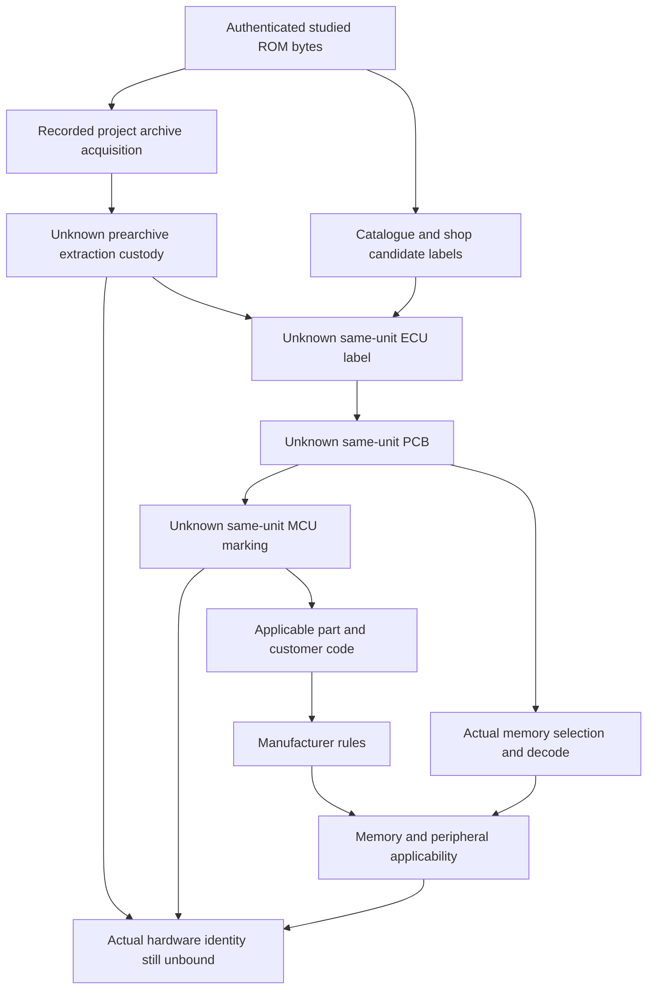

# M2cm: походження ROM та зв'язок із фізичним ECU

**`ROM_PROVENANCE_ESTABLISHED_HARDWARE_UNBOUND / EXECUTION_BLOCKED`.**

Встановлено задокументоване походження образу в цьому проєкті: публічний
Git-pinned firmware archive з автентифікованою відповідністю всіх 32768 байтів.
Походження дампу до цього архіву, конкретний ECU-донор, його PCB, MCU та фізична
периферія залишаються невідомими. Це різні рівні provenance. Жоден новий
документ, каталог чи стороння фотографія не закриває same-unit extraction chain.

У M2cm не завантажувався новий ROM payload і не виконувалися CPU, ROM, IRQ або
RTI. Production CPU/Bus/executor та admission не змінювалися. `FirmwareReady=false`.

Прийнята база — M2cl `cd5575a32d49dcc4109837fe8a58016889f9f5eb`; окрема гілка —
`codex/p28-word0196-ecu-rom-provenance-m2cm`. Final SHA — commit, який містить
цей документ і reviewed research package. Exact push, CI, canonical comparison
та working-tree state зафіксовані у завершених delivery receipts і фінальному
звіті; source-документ не містить самопосилального hash власного майбутнього commit.

## Межа вже відомого з M2cl

M2cl зберігає стандартні MSM66201/66207 memory maps, package/OTP відмінності,
PSW MIE bit8 у Japanese Y3 та customer-specific qualification manufacturer ISA.
Вони не відкривалися заново як нові знахідки M2cm. DATA03F0..03F7 і047E/F можуть
бути internal207 RAM або external201 DATA; PROGRAM54EA/54F0 можуть бути external
PROGRAM на201. Окремі 64-KiB PROGRAM/DATA spaces не об'єднано. 32-KiB файл не
встановлює on-chip ROM, периферійну ревізію або safe actual stack.

M2cj/M2ck RX READY frontier також збережено: 0262→0269 є умовним програмним
шляхом, actual DATA03F3 write generation не доведено, current SSP і safe IRQ
frame невідомі. Read-ACK, reassertion, set/clear ordering та IE wording conflict
не розв'язані. RTI не виконували в M2cm. Статична адреса0055 не стає фізичним
SRBUF лише завдяки збігу стандартної таблиці.

## Походження образу: що саме підтверджено

| Ланка | Доказовий результат | Розрив |
|---|---|---|
| Початковий project profile/catalog label | Позначення існувало до записаної acquisition; історичні Git records відокремлено від payload | Сам label не був незалежною перевіркою ECU-донору |
| Project acquisition | Accepted M1a dossier записує повне отримання з pinned public archive; повні32768 bytes і Git-blob binding відповідають admitted copy | Оригінального raw HTTP transcript у перевіреному compact dossier не знайдено |
| Archive transport/history | Нові exact GitHub commit/path-history metadata підтверджують2024 import і same-blob deduplication | Import/dedup не є датою фізичного зчитування ECU |
| Старий attachment record | Історична таблиця містить2004 upload metadata й unknown origin | Автор дампу, конкретна плата, extraction method та заводська оригінальність не підтверджені |
| Поточний admitted файл | Незмінна історична byte identity збережена | Немає linked ECU label/PCB/MCU/extraction-custody record |

Категорія **B** стосується джерела придбання файлу проєктом — публічного архіву.
Категорія **E** стосується попереднього фізичного походження — unknown.
Вони не суперечать одна одній. Technical third-party dump або modified/repacked
prearchive payload залишаються альтернативами, а не встановленими фактами.
Формулювання «original ROM» у старому software scope не доводить factory originality.

Нова перевірка M1a inspection script виявила важливу qualification: його length,
SHA/blob та before/after equality обчислюються з фактичних bytes, але записані
retrieval timestamp/status/content type були переданими literal metadata, не
значеннями HTTP response object цього script. Подію придбання підтримує accepted
contemporaneous dossier; M2cm не представляє ці поля як новий незалежний HTTP
observation. Історичні записи не переписано. Нових payload GET не було.

Новий `ecu_rom_provenance/acquisition_audit.json` — знеособлена декларація
локального source-qualified аудиту. Вона має власний byte binding у contract,
але не замінює primary HTTP transcript, приватні source receipts або апаратне
спостереження. Public CI перевіряє цю декларацію, а не повторює приватне придбання.

Public-safe джерела: [M1a report на прийнятій базі](https://github.com/Pvitaly91/HondaEcu/blob/cd5575a32d49dcc4109837fe8a58016889f9f5eb/docs/M1A_REAL_ROM_FINDINGS.md)
та [кореневий preservation archive](https://github.com/hondabase/files-archive).
Приватні filename, download path, ROM SHA/CRC/blob, локальні extraction records
та OEM payload bytes не опубліковано. Exact source-bound custody receipts
збережено локально. Правильна checksum не підвищує цей provenance до factory proof.

## Нові предметні апаратні джерела

Дослідження обмежено ідентифікаторами, знайденими раніше: P28-A01/A51,
MSM66207-251, code304,11F0/1720 boards. Нового широкого пошуку RX ACK не було.
Цільові результати дали shop-maintained list, retail fitment catalogue та дві
читабельні фотографії інших commercial ECU. Відтворювані source bytes/hashes і
bounded failures збережено приватно; фотографії/HTML не додані до Git або CI.

| Джерело | Нове твердження або спостереження | Доказова межа |
|---|---|---|
| [HA Motorsports ROM-number list](https://www.hamotorsports.com/pages/obd1-ecu-rom-number-to-ecu-part-number-master-list) | Автори називають список результатом logged units;251 пов'язано зA01/A51,304 — зA02/A52 | Self-reported shop observations, не manufacturer cross-reference; немає paired dump/photograph custody |
| [HondaPartsNow1993 Civic ECM catalogue](https://www.hondapartsnow.com/oem-1993-honda-civic-engine_control_module.html) | A01 listed дляKA5MT EX/EX-S/SI;A51 дляKA4AT EX/EX-S | Сторонній retail OEM-fitment catalogue, не прямий Honda silicon/PCB document |
| [DGTune product gallery](https://dgtune.shop/products/p28-spec-chipped-obd1-ecu-package) | У прочитаному фото співіснують labelA02,11F0/A8Y-E та literal MCU M66207-304 | Commercial modified/socketed examples; автор і дата фото невідомі, ROM dump не прив'язаний |
| [Seller listing255583922331](https://www.ebay.com/itm/255583922331) | У прочитаному фото співіснують labelA01,1720/A8Y-D та literal MCU M66207-251 | Multiple-quantity listing іншого ECU; label/assembly authenticity та source custody не доведені |
| [HA P28-equivalent service description](https://www.hamotorsports.com/pages/what-is-a-p28-equivalent-ecu) | Shop описує перетворення інших11F0 boards додаванням компонентів | Реальний приклад modification ambiguity, не доказ зміни саме досліджуваного ECU |

Зміст shop list не означає, що він вичерпний або унікальний. Саме джерело також
попереджає: після socketed-chip modification заводський ROM number більше не
ідентифікує програму, яку ECU реально використовує. Manufacturer semiconductor
sources не підтвердили числову suffix→Honda model/peripheral revision таблицю.

### Фотографії: буквальне прочитання, окреме від рекламного опису

| Поле | DGTune gallery image | Seller image |
|---|---|---|
| Visible connector label | `37820-P28-A02` | `37820-P28-A01` |
| Visible PCB | `02D011F0-1500 A8Y-E` | `02D01720-1500 A8Y-D` |
| Literal MCU top marking | **`M66207-304`** | **`M66207-251`** |
| Package observation | Elongated DIP-style, exact package code unknown | Elongated DIP-style, exact package code unknown |
| Memory-region observation | Populated socket/chip region; device identity/selection не встановлені | Видимий незаповнений27256 outline; окрема daughterboard в іншій частині |
| Original photographer/date | Unknown | Unknown |
| Link to studied ROM | None established | None established |

Обидва JPEG переглянуто повністю незалежно двома агентами. Читання спирається на
pixels, не на автоматичні image-search captions. Exact byte identities:

- [DGTune JPEG](https://dgtune.shop/cdn/shop/files/s-l1600.jpg?v=1683810058&width=1946):478782 bytes,
  SHA-256 `9377ce0ad3d5960b27822be928a6e0471cc1155eed31cd5c2f7e2354575e5aa2`.
- [Seller JPEG](https://i.ebayimg.com/images/g/VDAAAOSwGaNkwRt3/s-l1200.jpg):400206 bytes,
  SHA-256 `9a2db02fbe46f7195e6647f9b2d78648ac21be6d7c40e99bad3980773c5ab866`.

Це дві різні картинки, але їхній первинний photographic/republishing chain
невідомий. Вони не рахуються двома незалежними factory witnesses. Filename
`s-l1600` не доводить автора або original-camera custody. Оголошення з багатьма
продажами не з'єднує sample photo з кожним проданим unit. Exact package suffix,
pinout, electrical condition, EA strap і factory-unmodified status із цих фото
не встановлено. Literal **M66207** не перейменовано на **MSM66207** як новий
manufacturer-defined alias; зв'язок із named standard candidate є умовним.

Raw eBay HTML access дав403, хоча web-rendered listing та сам JPEG доступні;
цю різницю збережено. EJ9 anatomy article прочитано через web-rendered text, але
raw acquisition не відбувся через URLError. Його associationA01→11F0/AY8-D
залишається вторинним і не є універсальним: нове seller photoA01 має1720/A8Y-D.
Помилку доступу не видавали за автентифіковані document bytes і не обходили
security settings. Жодне з цих джерел не є фото досліджуваного донору.

## P28-A01, P28-A51 та code304: що стало точнішим

M2cl source-qualified catalogue association304→A01/manual збережена історично.
Новий shop list повідомляє251→A01/A51 і304→A02/A52; фотографії інших плат
узгоджуються з частиною нових relations. Це **non-exclusive attribution
discrepancy**, не доведена логічна суперечність. Обидва списки допускають різні
unit revisions, variations і невідому modification history. Без однакового
unit scope та взаємно виключних тверджень не можна оголосити один список
правильним, інший помилковим або вибрати donor за filename.

P28-A01 іA51 відрізняються documented retail fitment MT/AT; цього недостатньо
для висновку про однакову PCB, I/O або MCU. Bomarc A51 drawing із M2cl
позначає `MSM66207-251`,1720 board, окремі ASIC/MSM6434/82C55 та optional external
EPROM. Нове A01 photo також має251/1720, але це не доводить взаємозамінність
плат, точність конкретної optional net або same-unit dump.

Для code304 додано предметний A02/11F0 photo example іA02/A52 shop claims.
Actual studied ECU через це **не narrowed** доA02,207 або будь-якої PCB.
Дослідження стало точнішим у розмежуванні кандидатів і потрібних перевірок,
а не створило відсутній extraction link.

Manufacturer Y3/Y4 page2 називають `xxx` **code number** і окремо перелічують
package suffixes. Community catalogue інтерпретує номер як internal program
identifier. Пряма manufacturer authority для конкретного251/304 ROM mask,
customer program або peripheral-layout semantics не знайдена у цільовому
scope. Різні codes можуть мати сумісний core; за цим не встановлено однакову
I/O/IRQ allocation чи фактичне програмне наповнення після modification.

## Hardware compatibility matrix

Machine-readable matrix має **60** комбінацій:5 ECU labels
`A01/A51/A02/A52/Unknown` ×4 standard MCU candidates ×3 memory premises.
Кожен row зберігає `physicalUnitBound=false`, `actualSiliconConfirmed=false`,
`peripheralApplicability=Unestablished`, `executionAdmission=false`.
ECU label у такій таблиці є candidate, не доказом on-board silicon.

| MCU candidate | Premise:32-KiB internal-only | Premise:documented external PROGRAM supported | Actual configuration unknown |
|---|---|---|---|
| MSM66201 | Суперечить саме16-KiB стандартній internal-only premise | Умовно сумісна PROGRAM capacity, board decode не доведений | Unknown |
| MSM66207 | Умовно сумісна capacity, physical selection не доведений | Умовно сумісна PROGRAM capacity, board decode не доведений | Unknown |
| MSM66P201 | Та сама nominal16-KiB counterpart qualification | Умовно сумісна, без OTP programming-mode proof | Unknown |
| MSM66P207 | Умовна nominal32-KiB counterpart capacity | Умовно сумісна, без OTP programming-mode proof | Unknown |

«Суперечить» не виключає201 із зовнішньою пам'яттю; воно заперечує лише явно
задану32-KiB **internal-only** гіпотезу для стандартного16-KiB part. Жоден row
не називає весь actual ECU доведено сумісним. Capacity fit не доводить ISA
completeness, clocks, actual fetches, DATA permissions або периферію.

Actual external PROGRAM selection потребує board/EA/PSEN/decode доказів;
external DATA — RD/WR/decode/storage. Фото заповненого socket або незаповненого
27256 outline не замінює цього. Стандартні ALE/P0/P1/RD/WR/EA rules успадковані
з manufacturer pages, але actual wiring і активність не спостерігались.
SFR/interrupt/serial/timer/WDT/register-bank та фізичний stack залишаються
окремими applicability obligations. Окремий ASIC у Bomarc не означає custom
peripheral усередині основного CPU.

## Same-unit evidence graph та незалежні перевірки

Closed graph містить **14 nodes /18 relations**: studied ROM, acquisition,
claimed model, observed label, PCB, observed MCU marking, candidate MCU,
customer code, manufacturer source, memory map, peripheral applicability,
actual identity, extraction custody та board memory configuration.

Кожне ребро має source reference/hash, evidence class, confidence rationale,
applicability, provenance, unresolved conditions, competing hypotheses та
required confirmation. Поля actual-unit observations — null. Readable
commercial examples збережено окремо від observed studied-unit nodes.

Community catalogue + ROM length + ISA compatibility не можуть створити
`ActualSiliconConfirmed=true`. Висока кількість indirect references не замінює
одного verified same-unit link. Conflict detector розділяє nonexclusive
attribution, dependent copies, різні subjects та exclusive same-unit conflict
лише за явно заданих typed premises. Він не автентифікує чужі assertions.

Незалежний expected/reference frozen перед model output і не викликає analysis
для визначення expected. Повний deterministic stream містить **9 records**:
source inventory, provenance chain, hardware examples, attribution relations,
compatibility matrix, graph, static backlog, acquisition checklist та authority.
Actual hardware observation залишається null. Machine-readable evidence є
документальним результатом, не runtime journal або hardware oracle.

Substantive negative controls відхиляють A51→A01 donor promotion,32-KiB→207
identity, suffix→revision, ISA→actual board, checksum→factory original,
third-party photo→same unit, family→RX ACK, RAM capacity→safe SSP та
research PASS→execution admission. Missing/changed hashes, source-kind relations,
graph edges, ownership flags та output/source collisions також перевіряються.
Фактичні test counts і PASS/FAIL беруться з виконаних QA receipts.

## Продуктивна статична реконструкція без фізичного ECU

Відсутність донору не зупиняє всі software-only напрямки. Backlog класифікує
вже reviewed bounded regions; нового повного disassembly або execution немає.
Усі вісім позицій мають source/contract bindings, scope і окремі blockers.

| Priority/category | Придатна ділянка | Що можна довести / наступний bounded результат | Чого це не доведе |
|---|---|---|---|
| A1 — статично зараз | M2av/M2bd word0196 IR/C11 та reviewed threshold/gate/RMW CFG | Контрольні та data-flow relations, exact local algorithm, ordered software effects за explicit inputs | Physical RPM, фактичні значення або native generation owner |
| A2 — статично зараз | M2cj conditional parser0262→0269 та r5 comparison | Умови читання/запису, read suppression, branch dependencies й збережені unknowns | Що ready/event стався або current DATA03F3 належить цьому writer |
| A3 — статично зараз | Mask/shadow/mode writers і checks54EA/54F0/3F14/3F28/3E81 | Відношення static writes і consistency predicates за explicit mode/state premises | Atomic hardware update, reaching history або current masks |
| B — додаткова ISA | Неповністю встановлені instruction-specific effects/termination predicates | Primary-source semantics proof перед розширенням bounded models | Physical peripheral behavior чи native entry |
| C — memory map | RAM/SFR/bank/stack aliases | Candidate-qualified alias та access obligations із applicable part/board rules | Safe actual SSP/frame без owner/custody |
| D1 — фактична периферія | RX READY/ACK/reassertion | Applicable primary serial/controller rules та їхню source agreement | New IRQ delivery або actual SRBUF owner |
| D2 — фактична периферія | WDT/reset/timer boundaries | Правила applicable hardware variant без вигаданих progress events | Physical reset/clock/timing або scheduler evolution |
| E — native observations | Frame creation, IRQ/RTI та foreground continuation | Лише сформувати точні майбутні owned-state/journal requirements | Current safe frame, native return або downstream integration |

Найкорисніший наступний software-only напрямок — typed conditional contract
Flag producer `0262→0269` і mode/shadow consistency для вже reviewed sites,
з explicit symbolic inputs та незалежним reference. Результат M2av слід
використати як наявну базу, не відкривати повторно. Це не потребує фізичних ECU
тверджень. Вибір наступного етапу потребує окремого дозволу; M2cn не починається
автоматично.

## Мінімальний physical evidence packet

Це перелік **наявних записів/матеріалів для отримання**, не інструкція з розкриття,
електричного підключення, зчитування або перепрошивання ECU. Фізичне втручання
у межах M2cm не запитується. VIN і персональні дані не потрібні.

| Матеріал | Яку unknown усуває | Самостійно достатній? | Додатковий зв'язок із ROM та retained conditions |
|---|---|---|---|
| Повне читабельне фото ECU label | Claimed model проти observed part | Ні | Same-unit board record та extraction custody; case/lid могли бути замінені |
| Exact OEM Honda part number у записі | Варіант/fitment candidates | Ні | Перевірити source authenticity і label linkage; part number не визначає current firmware |
| Існуюче фото PCB top | Component population/markings | Ні | Потрібен зв'язок із label і dump; sample photo іншої плати недостатньо |
| Існуюче фото PCB bottom | Board routing/revision/modification context | Ні | Той самий unit/session provenance; electrical net assumptions залишаються умовними |
| Читабельна PCB revision | 11F0/1720 та revision discrimination | Ні | Same-board photographs і modification history; revision не є ROM hash |
| Повне MCU top marking | Part/customer-code candidates | Ні | Same-board custody, manufacturer alias/code bridge; цифри не встановлюють peripheral revision |
| Package/orientation record | Вибір applicable pinout/package | Ні | Manufacturer package relation та same-unit marking; це не вимір сигналів |
| Existing external-memory/ASIC identifiers | Memory population і separate-device identity | Ні | Board decode/EA/modification records; socket population не доводить active selection |
| Existing ROM dump/extraction provenance | Donor→admitted bytes chain | Ні | Exact privately checked full-image identity, custody і source authenticity; checksum недостатньо |
| Hardware modification/replacement history | Stock/internal-program assumptions | Ні | Сумісні before/after unit records; current configuration/peripheral owners можуть лишатися unknown |

Кожен елемент перевіряється разом із documentary chain до того самого ECU й
приватною повною byte identity admitted image. Переписаний filename або
host-generated unit ID не створює такого link. Навіть повний packet не
автоматично дозволяє IRQ/RTI: applicable ACK/IE/reset semantics, native frame
creation, current generations і return continuity потребують окремих доказів.

## QA, privacy, preservation та фінальний delivery scope

Пакет `research/p28-word0196/ecu_rom_provenance/` ізольовано від production.
Research-only CI має перевіряти exact reviewed sources, independent static
reference, negative controls і повні canonical artifacts на Ubuntu/Windows.
При preparation тут не оголошуються майбутні PASS, test counts або CI jobs.
Actual execution results, exact SHA/run/attempt і byte comparison зафіксовані
в завершених receipts та фінальному українському звіті.

Історичні contracts/oracles/manifests/fingerprints/reports M2cj/M2ck/M2cl не
змінюються. Три inherited preservation exceptions залишаються окремими;
strict historical/whole-storage PASS із них не виводиться. Scoped protected
audit має показати new unauthorized differences=0 і зберегти unrelated files.
Дозволена current workflow change звітується окремо, historical expected SHA
не переписується. Historical17 та Desktop — NotRun, якщо їх не виконано.

Git і CI не містять private ROM, приватних raw acquisition/extraction records, OEM payload,
HTML/JPEG scans чи temporary dumps. Public source hashes фотографій
ідентифікують documentary pixels, не роблять ці фотографії actual donor evidence.
NAS, cache copies, нові worktrees та повторні великі runtime corpora не потрібні
для цього bounded documentary пакета.

**`ROM_PROVENANCE_ESTABLISHED_HARDWARE_UNBOUND / EXECUTION_BLOCKED`.**
Project archive acquisition встановлено в чітко визначеному recorded scope;
prearchive donor, фактичний MCU і peripheral applicability не встановлено.
Static reconstruction backlog дозволяє наступний продуктивний software-only
напрямок, але не є дозволом його виконати. `FirmwareReady=false`.
