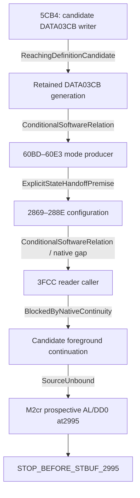

# M2cu — mode producer, DATA03CB та caller continuity

## 1. Прийнята база M2ct

Незмінна база — `531b3859a5b63b42ba597fe0a79be408dea151ff`.
M2ct установив умовний configuration reader, два локальні producer prefixes
та software reaching definitions; прийнятий статус —
`CONDITIONAL_CONFIGURATION_READER_AND_PROVENANCE_ESTABLISHED / EXECUTION_BLOCKED`.
Базові 92/92 static tests, 1845 canonical records і 56820871 decompressed bytes
належать прийнятій M2ct, а не новій перевірці M2cu. Пакети M2cn–M2ct, їхні
contracts, source bindings, reference oracles та expected streams залишаються
історичними залежностями. Новий пакет — `mode_caller_continuity`.

Мета M2cu — source-qualified програмні залежності. Жодний умовний результат
не створює native caller, поточного власника RAM або дозволу виконання ROM.

## 2. Точний новий source scope

Додано 25 декларативних source relations: десять для `5CA5–5CB4`, сім для
розширення mode producer та вісім для caller/reader continuations.
`source_inventory.NEW_SOURCE_ROWS` містить PC, абстрактну instruction form,
довжину, successors і точні printed/PDF locators. Original instruction bytes,
ROM payload, source listings та приватні шляхи не публікуються.

| Scope | Додаткові PC |
| --- | --- |
| Indexed writer | 5CA5, 5CA7, 5CA8, 5CA9, 5CAB, 5CAC, 5CAD, 5CAF, 5CB2, 5CB4 |
| Mode extension | 60BD, 60C0, 60D7, 60DA, 60DD, 60E0, 60E3 |
| Caller і continuations | 2869, 288E, 3FCC, 3FCE, 3FD0, 3FD2, 3FB1, 3FF7 |

Базові 111 contract relations і додаткові 25 дають 136 relations.
Це не твердження про 136 унікальних PC, 136 нових instructions або whole-ROM
coverage. Допоміжний wider CFG може бути source-qualified без його виконання
або включення кожного вузла до математичної функції.

## 3. Source-qualified DATA03CB writer inventory

Новий локальний writer установлено для `5CA5–5CB4`. За supplied symbolic
P2 та ADC bytes:

```text
index = (P2 >> 5) & 7
selected X1 = index
DATA[03CE + index] = supplied ADCR1H
DATA[03C6 + index] = supplied ADCR0H
STOP before 5CB7
```

Отже, `5CB4` записує DATA03CB тоді й лише тоді, коли index=5 у цьому
кваліфікованому prefix. Джерело значення — supplied ADCR0H, а не reset/default,
поточне peripheral observation чи реконструйований hardware sample.

Логічний порядок writes: selected X1 у `5CAC`, indexed byte у `5CAF`,
indexed byte у `5CB4`. Кожний store зберігається навіть за незмінного значення.
X1 фізично відповідає `0080 + 8*SCB` та наступному байту. `0086 + 8*SCB`
належить USP і не підставляється замість X1.

## 4. Підтверджені, умовні та виключені candidates

| Candidate | Класифікація та умова |
| --- | --- |
| 5CB4 indexed byte store | ConfirmedLocalWriterRelation за index5 та доведеного prefix |
| 2710 initialization word store | ConditionalWriterCandidate, якщо конкретна ітерація DP адресує aligned03CA і A=0 |
| 5CAF indexed byte store | Виключений для03CB лише в доведеному index0..7, де EA03CE..03D5 |
| 495D pointer load і наступний read | Read-only relation; текстове посилання03CA не є write |
| Local r3 / er1 | Можливий alias03CB /03CA–03CB за відповідного LRB; не поточний власник |
| Current-page offCB | Можливий alias03CB за current page03; невідомий page не замінюється відомим |
| DP/X1/X2/USP, RMW і stack/callee effects | Conditional alias або UnknownInterference до встановлення EA/context |

У перевіреному decoded inventory не знайдено exact direct absolute byte store03CB
чи direct absolute word store03CA. Це обмежений результат перевірки instruction
forms, а не доказ відсутності інших writers. Inventory не є вичерпним global
ownership proof; нерозв'язані indirect, initialization та call/frame effects
зберігаються як candidates.

## 5. Розширений CFG mode producer

`60BD` порівнює local r0 з нулем; за LRB0041 це DATA0208.
`60C0` веде до `60C9` за ZF1 або до `60C2` за ZF0.
Unknown predicate дає indeterminate exit у `60C0` без speculative03CB read.
Ненульовий шлях має відомі source edges через PROGRAM-table-dependent
`60C2–60C7`, але нова функція зупиняється перед `60C2`.

На нульовому шляху використовується незмінний M2ct Compare3cb:
`60C9 → 60CC → 60CF → 60D2 → 60D5`.
Після нього доведений suffix:

```text
60D7: A = 0700; DD = 1; ZF = 0
60DA: inspect current-page DATA0216.bit3
        1 -> keep A0700
        0 -> 60DD: A = 0500; DD = 1; ZF = 0
60E0: selected DP = 0382
60E3: DATA0382/0383 = A, little-endian
STOP before RT60E4
```

Перед reached60DA потрібен known LRB із `(LRB & 1FE0) == 0040`, тобто
current page0200. Інакше LocalPage0216NotEstablished зупиняє prefix у60DA
післяL0700, перед DATA0216 read і branch step. Це окрема перевірка від
exact LRB0041 для local r0 у60BD. Direct Compare3cb/SymbolicCarryTail
не отримують раннього global LRB0041 gate.
Unknown0216.3 зберігає вже отриманий A0700 і зупиняється у `60DA`.
RT60E4 потребує native SSP/frame; return address не вигадується.

## 6. Походження DATA0356.1

За прийнятих ISA/context premises frozen Compare3cb формує:

`new DATA0356.1 = retained DATA03CB.bit7`.

M2cu додає конкретний локальний producer candidate для DATA03CB і ширший
source prefix/suffix. Це звужує походження значення, але не встановлює,
що саме цей writer був останнім native writer перед `60CC`.

Реальні source call sites `276A/2B64 → 5C86` та
`27D0/4069 → 5F45` є статичними фактами. Їхні можливі return sites не
засвідчують виконаний call, збережений frame або досягнення `60BD`.
Кожне reaching-definition твердження потребує точного generation і окремого
path/no-interference premise.

## 7. CF, ZF, PSWH та partial knowledge

Writer зберігає `CF = original P2.bit4`: SRLB у `5CA8` записує CF,
але не ZF. SWAPB зберігає flags; ANDB у `5CA9` визначає ZF за index.
EXTND після маски0..7 дає AH00 і DD1. Наступні byte loads встановлюють
DD0 і ZF за відповідним supplied byte; unknown і knownBits зберігаються.

CMPB r0,#0 у `60BD` дає CF0 для кожного byte value, але unknown r0
може залишити ZF unknown. Frozen `XORB PSWH,#80` у `60CF` не отримує
довільно обраного implicit/explicit ZF priority. Його historical ambiguity
залишається в nested result. Новий `L A,#0700` у `60D7` законно
перезаписує ZF значенням0 за власним nonzero result. Це новий source effect,
а не ретроспективне вирішення XOR ambiguity.

## 8. Callers TX configuration

Безпосередні source predecessors `2869`:
taken `284F JEQ` за відповідним diagnostic predicate або fallthrough
після indexed store `2864`. `2869` записує32 у current-page offCD;
за LRB0041 effective address — DATA02CD.

Далі immutable M2cs configuration `286D–288C` зберігає accepted semantics.
У `288E` selected DP стає4700; зупинка —
`STOP_BEFORE_EXTERNAL_DATA_READ_2891`. У цьому bounded fragment немає
CAL, RT, RTI або stack access. Це не усуває frame/context obligations
ширшого enclosing path.

У retained decoded scope немає direct call target286D; його immediate
source predecessor —2869. Unbound/computed/native alternate entry не
виключається таким inventory.

## 9. Caller configuration reader

Новий source entry — `3FCC`: LB бере supplied symbolic ADSCAN byte0058,
замінює AL, зберігає AH, встановлює DD0 та ZF за новим AL.
Incoming DD може бути0,1 або unknown: саме source LB визначає новий DD.

Далі `3FCE` маскує AL через5F, `3FD0` порівнює з10,
а `3FD2` перевіряє ZF. Mismatch веде до3FB1; match передає стан до
незмінного M2ct reader `3FD4–3FF5`. Unknown comparison зупиняється
indeterminate у3FD2, зберігаючи повний доведений prefix.

Це supplied symbolic readback із власною generation, а не фактичний SFR read.
AL/DD не підміняються host-selected constants між configuration output і3FCC.
Direct call target3FD4 не встановлено; source edge — not-taken branch3FD2.

## 10. Незалежний review меж3FB1 та3FF7

| Вихід | Доведений новий effect | Наступна зупинка |
| --- | --- | --- |
| 3FB1 | Zero-page byte store DATA00F5=50; flags/registers retained; same-value store залишається подією | STOP_BEFORE_BRK_3FB5 |
| 3FF7 | Little-endian word DATA00FA/00FB → AL/AH; DD1; ZF=zero16(A); CF/HC retained | STOP_BEFORE_IE_WRITE_3FF9 |

BRK3FB5 не застосовується як reset, fallthrough, RT або повторний запуск
configuration. Після3FF7 не виконується IE write чи timer read.
Ці виходи мають різні source effects і не зливаються в одну synthetic route.
Unknown word зберігає per-byte/per-bit knowledge; DD1 установлюється й тоді,
коли значення word невідоме.

## 11. Writer-generation lineage

Значення й generation — окремі частини стану. Same-value write створює
нову writer generation; рівність endpoint values не відновлює походження.
Потрібно зіставити generation створену5CB4, retained03CB перед60CC,
нову0356.1 у60D5 та configuration/readback generations.

Typed reaching-definition outcomes розрізняють локальне writer relation,
умовне збереження, competing writer, stale/missing generation,
unknown interference, невстановлений path і source conflict.
Позитивний conditional outcome не є native RAM ownership.

## 12. Можливі intervening writes

Startup word clear2710, інша ітерація indexed acquisition, alias через
невідомий DP/X1/X2/USP, local bank/current page, RMW, stack або callee можуть
порушити retained lineage. Кожний потребує source/context qualification.

На визначеному configuration-to-reader static path немає явного direct
DATA0356 write. Сильніше твердження потребує retained LRB0041, правильного
USP і виключення asynchronous/unbound writers. Зокрема,2896 за USP0180
адресує0119; інший USP може створити alias0356. Generation не доводить
відсутності такого втручання.

## 13. Умовний dependency graph



Граф є класифікацією доказів. ExplicitStateHandoffPremise переносить повний
математичний snapshot і generations; він не створює CFG edge, scheduler,
call/return, hardware observation або нову execution authority.
Навіть усі supplied premises=true не дозволяють actual2995 write.

## 14. Confirmed і непідтверджені CFG edges

Підтверджено local fallthrough/branches writer prefix, zero/nonzero branches
60C0, suffix після60D5, caller2869→286D та288E→2891, reader prefix і обидві
нові continuation boundaries.

Wider source path configuration→verifier має конкретні guards для SSP,
DATA0400, PSW/LRB, port/TCON/PWM/ADC readbacks. `28AB` має direct successor
`3F47`; послідовний перехід до28AE не підставляється.
Наявність цих статичних edges не означає, що їхні predicates були виконані.

Native return60E4, execution order writer→mode→configuration, retained
configuration→actual readback та reader→foreground→2995 залишаються
умовними або blocked. VCAL3 table target28AE не робить286D чи3FD4
vector targets і не доводить balanced return.

## 15. DATA4700 applicability

DATA4700 — зовнішній DATA access candidate у2891, окремий від PROGRAM4700.
Його physical memory applicability, значення й owner не встановлені.
DP4700 є source-qualified register assignment, але не дозволом читання.
Тому configuration caller завершується перед2891. Аналогічні згадки
DATA4700 у ширших candidate paths не закривають reaching definition.

## 16. Primary STCON/TX documentation

Виконано bounded search із12 нових queries та3 candidate opens.
Нової applicable operation manual/errata або STCON allocation не отримано.
June1990 fifth-edition data book уже був відомий проєкту: збережений PDF
повторно використано локально, а не оголошено новим документом.
Релевантні preliminary MSM66201/66P201 і MSM66207/66P207 sections
printed363–383 та384–404 перевірено; вони лише підтверджують SFR/reset metadata.

Успадковано17 documentary facts і15 unknowns. Невстановленими залишаються
STCONbit7, length/stop/parity encoding, TX write/read ACK, reassertion,
full-holding/third-write collision, set/clear priority та safe mid-TX changes.
Printed165/168/169 і167 зберігають IE polarity conflict.
CRC-failed114/115,116/117,122/123 залишаються excluded; missing132–147
не реконструюються. SRCON encodings не переносяться на STCON; reset80
не означає current state або TX enable. Результат пошуку не є доказом
глобальної відсутності джерела чи same-unit peripheral applicability.

## 17. Нові pure-function interfaces

| Interface | Declared source scope | Complete outcome або основна межа |
| --- | --- | --- |
| data03cb_indexed_writer | 10 writer PC | IndexedAdcBytesStored; before5CB7 |
| mode_producer_extended | 12 PC, включно з frozen producer | ConditionalModeWordPrepared; beforeRT60E4 |
| configuration_caller | 18 PC: frozen16 плюс2869/288E | ConfigurationIntentsPreparedBeforeExternalRead; before2891 |
| configuration_reader_caller | 21 PC: frozen15 плюс6 caller/continuation sites | FailureDiagnosticPrepared або ReaderAcceptedBeforeIeWrite; before3FB5/3FF9 |
| data03cb_reaching_definitions | 5CB4,60C9,60CC,276A,27D0,2710 | Typed generation/path/interference relation |
| cross_block_source_join | Sorted union перших4 scopes та2995 | ConditionalSoftwareCompositionOnly; остання reader boundary |

Перші чотири мають StaticRomSoftwareEffect classification, останні два —
ConditionalSoftwareRelationship. Немає нового documentary API без нових
operation rules. Reader continuation — internal helper, а не сьомий
public interface. Immutable adapters зберігають accepted nested results
і не дублюють історичні instruction semantics.

Declared sourceScope є межею перевіреної семантики, а не списком retired
instructions. Writer додатково повертає selectedIndex і
conditionalData03cbWriterEstablished; друге полеtrue лише за
CompleteConditional та index5. Невстановлений selected X1 bank зупиняє
prefix у5CAC. Якщо effective indexed address не є єдиним, writer зберігає
prefix і architectural dependency read у5CAF, не читає ADCR0H і не створює
жодного indexed array store.

Mode entry має три варіанти: At60BD, Compare3cb, SymbolicCarryTail.
Два останні безпосередньо використовують відповідний frozen entry;
LRB gate застосовується лише там, де цього потребує нова instruction.
Ненульовий At60BD шлях завершується перед60C2 з
ProgramTableSourceNotAdmitted. Unknown source predicates не обирають гілку.

## 18. High-level pseudocode та synthetic example

```text
writer:
    derive index from supplied P2 through reviewed byte operations
    assign selected X1 with its physical DATA alias
    store supplied ADCR1H at 03CE+index
    store supplied ADCR0H at 03C6+index

mode:
    compare source local r0 with zero
    if unknown: stop at branch
    if nonzero: stop before unclosed PROGRAM-table path
    invoke frozen Compare3cb with exact retained state
    apply L0700, source bit3 branch, optional L0500
    assign selected DP0382; store word; stop before native RT

join:
    validate exact source bindings, generations and explicit premises
    hand off complete snapshots between bounded pure functions
    preserve every partial/refusal output and missing native edge
    stop before STBUF2995
```

Умовний synthetic приклад: supplied P2=A0 дає index5; supplied ADCR0H=80
створює DATA03CB=80 у5CB4. Нехай початковий DATA0356=00 і local r0
уDATA0208=0. За retained generation та решти явних premises frozen producer
формує DATA0356=02, тобто bit1=1. За окремого state handoff configuration
обирає default STTM/STTMR=DF, STTMC=12, STCON=1C, SRCON=8C.
Якби ADCR0H=7F, той самий умовний relation залишив би DATA0356=00,
mode0 і alternate FB/FB/12/31/A1. ADCR1H залишається окремим supplied input;
його попередній store не перейменовується на DATA03CB writer.
Це не виконання ECU, ADC measurement або native timeline.

## 19. Formal contracts і finite snapshots

Контракт фіксує finite DATA whitelist82 bytes, з яких33 додано до parent
snapshot. Symbolic SFR slots:0024,0049,004A,0050,0054,0058,0061,0063.
DATA bytes, software SFR intents і supplied symbolic readbacks мають окремі
spaces та generations; однаковий numeric address не ототожнює їх.

Algorithm snapshot має exact9 fields: inputClass, memory, knownBits,
registers, generations, assumptions, registerKnownBits, configurationIntents,
sfrReadbacks. Mode snapshot додає лише entry. Slot має nullable byte value,
knownBits і generation; жодного autofill/reset injection. State зберігає
сім відповідних maps/fields без inputClass і assumptions. Twelve architectural
registers, partial register bits та три accepted assumptions залишаються
явними. Wrong closed shape/type дає ValueError; unavailable premise повертає
typed result із доведеним prefix.

Source binding — exact dict із сімома string fields:
base, indexedWriterProof, aliasInventory, extendedMode, caller,
callerAdscan, primaryV2. Missing/extra keys, stale hashes та tolerant
type coercion не приймаються. Функції зберігають unknown/partial values,
precise branch outcomes, ordered writes і першу недоведену boundary.

Formal reaching query містить initial DATA03CB slot,0..32 ordered events,
path, entry/requested generations, noInterference та claim. Дозволені
IndexedWriter, AlternateStore і UnknownWriter descriptors. Вони не створюють
виконання writer prefix або вигаданих X1/ADCR1 writes у declared timeline.
Indexed source PC має бути5CB4, selected SCB — known, а positive03CB relation
потребує index5. Word alternate stores вирівнюються до even address.
Повторне використання generation label відхиляється навіть для nonoverlap
store. Unknown EA/можливе втручання не перетворюються на retained owner.

Лише WriterLocalEffect та WriterWindowRetention можуть дати позитивний
local relation; WriterTo60C9, Caller276ATo27D0 і ResetTo60C9 зберігають
ReachingPathUnestablished. Competing/Missing/StaleGeneration та SourceConflict
не зливаються з UnknownInterference. NativeOwner, ActualHardware і
RuntimeAdmission claims не приймаються як conditional ownership.

Cross query задає тільки порядок IndexedWriter → ModeProducer →
ConfigurationCaller → ReaderCaller. Кожний handoff має nullable bool premise;
false відхиляється, null лишається indeterminate, true переносить тільки
поточний повний mathematical state. Після writer з index≠5 композиція
зупиняється, не приписуючи старий DATA03CB цьому writer. NoInterference
перевіряється до першого stage. Formal stbufQuery перевіряється окремо;
його незмінний stbufObligations output не є доказом проходження до2995.

## 20. Independent reference comparison

Production pure functions і незалежний reference oracle мають окреме
походження реалізації, спільні immutable source premises та однаковий
deterministic output contract. Oracle не повинен читати expected stream
як власну implementation або викликати production model для нової семантики.

Повний результат порівнюється разом із refusals, nested outputs, states,
knownBits, generations, metadata та execution authority. Статичний source
review сам по собі не засвідчує independent equivalence PASS.

Independent expected stream заморожується до першого new-model comparison.
Source/wire corrections перед freeze походять із source review, а не з
підгонки expected під observed output. Unmodified-input control має передавати
саме original query до actual function. Validation не припускає однакової
форми кожного nested frozen result і не приховує missing fields через default.

## 21. Test coverage

Обов'язкова перевірка охоплює всі256 P2 values/index0..7, exact index5 writer condition,
SCB-selected X1 aliases, carry і ZF effects, same-value stores та unknown EA.
Mode coverage включає r0 zero/nonzero/unknown,0216.3 zero/one/unknown,
XOR ambiguity retention та legitimate ZF overwrite у60D7.

Caller/reader coverage має перевіряти exact prefix state, immutable adapter
refusals, source ADSCAN load, partial comparisons, failure diagnostic store,
success word load і всі stop boundaries. CI routing/publication controls
містять19 substantive test methods. Фактичні test totals і PASS визначаються
виконаними QA receipts; цей source document не видає заплановані runs за PASS.

Finite corpus охоплює також256 DATA03CB values,256 ADSCAN bytes і short-circuit
paths, unknown/partial CF/ZF/DD/SCB, усі шість operations та негативні
generation/EA/order/handoff/native claims. Page02 guard у60DA перевіряється
на reached boundary з утриманням L0700 prefix; він не стає global0041 gate.

## 22. Negative controls

Мають відхилятися writer без source proof, default/reset mode substitution,
unknown CF→0, довільний XOR ZF, пропущений CFG edge, fake return/SSP/frame,
stale generation та пропущений same-value store.

Окремо відхиляються повторний effect namespace, reuse generation label,
unknown selected X1 bank, невизначений indexed EA, неперевірений stage order,
missing/false handoff та reseeding AL/DD перед source ADSCAN load.

Окремо перевіряються заборони: software SFR intent→hardware owner,
symbolic readback→physical observation, reset80→current STCON,
STTMC write12→readback12, TX READY→TX COMPLETE, RX→TX IRQ, invented ACK,
reassertion або same-unit applicability. Будь-яке actual peripheral result,
ACK/pending generation, CPU retirement чи виконання STBUF2995 не може бути
сертифіковане publication validator.

## 23. Canonical results і finite CI

Canonical envelope має17 fields: caseId, operation, input, output,
sourceScope, sourceIdentities, evidenceClass, applicability, state,
branchOutcome, reads, orderedWrites, generations, intermediateStates,
unresolvedConstraints, stopBoundary, executionAuthority.
Generations містить data, softwareIntents, suppliedReadbacks, writerEvents
та reachingDefinitions. SourceIdentities на кожному record — повна копія
exact reviewed binding, включно з unknown/refusal records.

inheritedResults зберігає точні незмінні child outputs. Для aggregate copies
read/step/journal/intermediate metadata містить stage; journal та intermediate
додають stageOrdinal. Journal ordinal і intermediate afterOrdinal глобально
зсуваються, проте frozen afterGeneration labels та state generations не
перейменовуються. Parent/child extra DATA, readback slots і knownBits утримуються;
afterRegisters має всі12 registers, afterPointerState та afterX1State залишаються
окремими views. Якщо новий child уже містить afterX1State, aggregate copy
зберігає його точне значення; prechild fallback потрібен лише старим frozen
children без такого поля, які не записують X1. Жодний boundary marker не
створює retirement event.

Numeric boundary позначає точну локальну stop address. Незмінний global
stopBoundary/stbufStopBoundary лишається STOP_BEFORE_STBUF_2995;
CompleteConditional для cross join означає лише успішну математичну
композицію до останньої reader boundary3FB5/3FF9. SourceEdges зберігає
nativeContinuityEstablished=false та явні missing frame/scheduling/interference
proof obligations навіть за всіх premises=true.

Expected, local, Ubuntu та Windows порівнюються повними decompressed bytes.
SHA-256 доповнює byte equality; не замінює її. Counts, byte size, unique IDs,
firstMismatch, final commit SHA і фактичний CI status фіксують delivery receipts.
CLI publication окремо не сертифікує independent comparison або delivery.

Finite CI overlay додає19 public paths до1384 raw base files:
1403 raw files,1383 незмінених non-workflow base files. Historical workflow
tail74904 bytes зберігається byte-exact. Unknown або unreviewed change
обирає full historical QA fallback; historical jobs не пропускаються мовчки.

## 24. Preservation і execution authority

Зберігаються всі accepted M2cn–M2ct contracts, source manifests, oracles,
expected streams, reports, seals, runtime files та original ROM.
Успадковано шість documented exceptions: три inherited і по одному від
M2cn, M2cp, M2ct. Вони не стають новими M2cu exceptions.
StrictHistoricalPreservationPass залишаєтьсяfalse через inherited exceptions.
Нові unauthorized differences мають дорівнювати0 за фактичним audit.

Кожний новий output зберігає executionStatus=EXECUTION_BLOCKED,
firmwareReady=false, cpuInstructionRetirements=0 та
stbufStopBoundary=STOP_BEFORE_STBUF_2995. Actual hardware observation,
buffer write, transmission, TX completion, TX IRQ delivery та peripheral clock
event залишаютьсяnull.
Original ROM, CPU, IRQ/RTI, physical ECU, flashing і GUI не виконуються.
Historical17/Desktop позначаються NotRun, якщо їх фактично не запускали.

## 25. Готовність до C++/Rust

Bounded pure interfaces, explicit unknown, typed outcomes, immutable adapters
та deterministic full-output comparison дають специфікацію для перенесення
відповідних програмних алгоритмів. Потрібно зберегти byte/word widths,
little-endian representation, bank/SCB aliases, flags, generations та refusal
semantics. Host arithmetic не встановлює native ABI, memory ownership,
compiler suitability або firmware readiness.

## 26. Залишкові native/hardware blockers

Не встановлено global DATA03CB owner, фактичну останню indexed acquisition,
native retention до60CC, повний enclosing5F45 path/frame, return60E4,
producer-before-configuration timeline та actual configuration readbacks.

Також відкриті external DATA4700 applicability, wider verifier predicates,
VCAL/native return continuity, foreground-to2995 path, поточний TX buffer/
clock/request state, STCON full encoding, ACK/collision rules та IE polarity.
Навіть повний математичний join не перетворює ці gaps на hardware evidence.

## 27. Рекомендований bounded M2cv scope

Наступний окремо авторизований етап може дослідити один конкретний
source-qualified enclosing caller/return path та його intervening writes,
щоб звузити lineage indexed writer→mode producer або mode→configuration.
Перш ніж розширювати pure scope, слід установити потрібні PROGRAM-table,
callee-clobber, SSP/frame і address-applicability premises.

Primary recovery варто продовжувати лише за новим конкретним intact
operation-manual/errata locator. Повторення завершеного bounded search
без novelty не є новим доказом. M2cv не запускається автоматично;
EXECUTION_BLOCKED, FirmwareReady=false та STOP_BEFORE_STBUF_2995 зберігаються.
