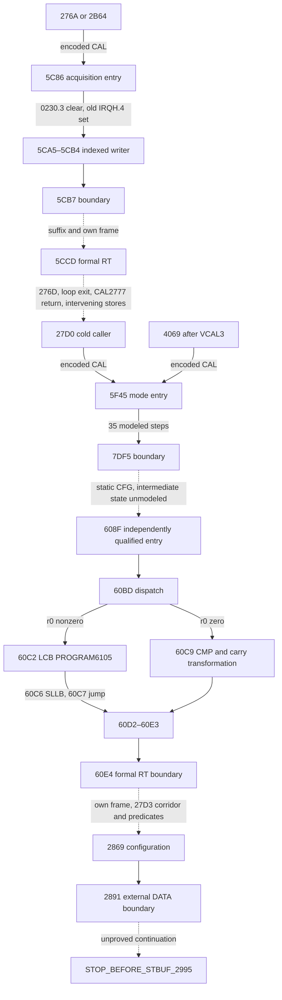

# M2cv — Enclosing callers, ordinary return obligations and DATA03CB lineage

M2cv uses the accepted M2cu tree at `a638a0cd0cbb03548f5e17fa7fd075d55fe307b3`.
M2cu verified the indexed writer at `5CA5–5CB4`, the conditional mode producer
at `60BD–60E3`, and the configuration and reader prefixes. M2cv adds the
caller context, two modeled fragments of the enclosing mode procedure, and the
guard before the indexed acquisition. The historical M2cc CFG and M2cd
instruction footprints qualify the intervening source.

[M2cu report](M2CU_MODE_PRODUCER_CALLER_CONTINUITY.md) ·
[M2cd CAL/RT and helper footprints](M2CD_CAL27D0_RT60E4_FRAME_PROVENANCE.md) ·
[M2aw register and memory contract](M2AW_NX8_200_TARGET_ABI_CONTRACT.md)

## Scope and caller graph

Solid edges below are encoded direct CAL targets or reviewed local control flow
with the indicated predicates. Dashed edges require the stated missing proof.
A corridor with multiple sites is a path summary.



| CAL site | Encoded target | Length | Candidate return | Context qualification |
|---|---|---:|---|---|
| `276A` | `5C86` | 3 | `276D` | Cold acquisition loop, retained DD1 interpretation |
| `2B64` | `5C86` | 3 | `2B67` | Different surrounding CFG, retained DD0 interpretation |
| `27D0` | `5F45` | 3 | `27D3` | Cold predecessor writes er0 at `27C3` with LRB0041 |
| `4069` | `5F45` | 3 | `406C` | Requires its own prior VCAL3 return from `4068` |

The VCAL3 operand uses PROGRAM vector `002E/002F` with target `28AE`.
Its encoded length is one byte, so its next-site candidate is `4069`.
One conditional route bypasses STBUF through `28B5→2997` and reaches the
unadmitted IE write at `2999`. Its completed return and full clobber set
remain unresolved. The accepted M2cc graph inside `5F45` has 226 nodes,
253 edges and one reviewed normal RT at `60E4`. It contains zero nested
CAL or VCAL sites. The caller's surrounding calls retain their separate
frame and register obligations.

## Enclosing mode software

`mode_enclosing_caller` accepts two typed entry variants. `From5F45` binds
the selected caller and requires an explicit conditional callee-entry
premise. It establishes AL=0, DD0 and ZF1 at `5F45`, then reads supplied
symbolic bytes at the exact PROGRAM operand sites. For each load and shift,
the source byte's high bit reaches CF. The corresponding MB preserves the
other destination bits while writing an ordered DATA generation. The
addressing contracts check the page at off-page operations, LRB0041 for
local r0/r1, and SCB for DP. The selected DP aliases use `0084+8*SCB`.

```text
require conditional entry, ordinary byte semantics
AL := 0; DD := 0; ZF := 1
for PROGRAM60E6, 60E7, 60EB, 60EC, 60ED, 60EE, 60F0 in source order:
    AL := supplied PROGRAM byte; ZF := zero(AL)
    CF := AL.bit7; AL := (AL << 1) modulo 256
    DATA[destination].bit := CF
DP := 0356; DATA[DP].bit0 := CF
AL := supplied PROGRAM[60F1]; ZF := zero(AL)
CF := AL.bit7; AL := (AL << 1) modulo 256
DATA0227.bit1 := CF
DP := 03C7; AL := DATA[DP]; ZF := zero(AL); r1 := AL
CF := 0
AL := supplied PROGRAM[60FB]; ZF := zero(AL)
J 7DF4; r0 := AL
stop before 7DF5
```

The 35-step prefix also writes DATA0356.0 and changes DP in source order.
The r0 store at `7DF4` supersedes the earlier cold r0=0 candidate from
`27C3`. In the reviewed LRB0041 graph, `7DF4` and `608F` dominate
`60BD`, and no other reviewed site after `7DF4` writes r0. This supplies
a static r0 reaching relation under the required map, alias and interference
conditions. The modeled prefix stops before the branch at `7DF5`.

`At608F` takes a separately supplied state with DD0 and LRB0041. It compares
r0 with zero. On the nonzero route, `6094` reads PROGRAM6104, shifts the byte
and jumps to `60BA`. On the zero route, `609B` clears CF and `609C` tests
DATA0217.6. If the bit is clear and PROGRAM6104 is nonzero, the source passes
the NOP corridor and compares DATA03CE with `9A`. At `60BA` the selected CF
is written to DATA0219.4. The next source site is the mode dispatch at `60BD`.
Unknown predicates stop at the branch. The detached input carries no implied
continuity from the prefix or the unmodeled middle.

## Fixed PROGRAM operand at 60C2

`program_table_path` uses the frozen M2cu dispatch. A zero r0 selects the
accepted DATA03CB compare and requires no PROGRAM6105 operand. A nonzero r0
selects `LCB A,N16` at `60C2`. This form reads one byte at the fixed
16-bit PROGRAM address `6105`. There is no indexed effective address or
r0-dependent range. The LCB updates AL and ZF, retains DD, and continues to
`60C6`. The byte shift establishes CF from bit 7 and preserves ZF. The
short jump at `60C7` leads to the accepted `SymbolicCarryTail` at `60D2`.
The old zero route retains the XOR PSWH ZF ambiguity in its intermediate
effects. A reached `L A,#0700` at `60D7` sets the new ZF through its own
documented effect. The `60DA` page condition remains
`(LRB & 1FE0) == 0040`.

The operand type includes PROGRAM space, exact address, byte width, null
index, source proof identity, and a symbolic slot with partial bits and
generation. Unknown/missing source, DATA-space substitution, wrong address,
an index, and a claimed OEM byte have separate refusals. The proof identity
binds the instruction and operand location. The public symbolic values carry
no private PROGRAM table bytes. The successful suffix writes the conditional
word at DATA0382/0383 and ends at `STOP_BEFORE_RT_60E4`.

## Callee effects and frame obligations

`callee_clobber_summary` reports a per-field source classification for a
selected reviewed phase. The entry prefix modifies AL, CF, ZF, DD, selected DP
and the listed DATA bits/local slots. The detached suffix and frozen mode
tail have their own AL/AH, CF/ZF/DD and DATA/DP footprints. Coverage of a
prefix gives no retention guarantee through the unmodeled middle or a
surrounding unresolved call. The summary tracks A and its halves, architectural
flags, OtherPSW, MIE, LRB/SCB, X1/X2/DP/USP/SSP, DATA and software SFR intent
scope. The qualified normal path writes AL/AH/A, CF/ZF/DD, OtherPSW and
DP. HC is conditional through the logical PSW caveat. MIE, LRB, SCB,
X1/X2, USP, SSP and software SFR intents are retained within that
qualified pre-RT scope. The `4068` predecessor of `4069` has unknown
callee effects for the separate pre-entry phase. The summary applies
no compiler ABI rule.

`call_return_obligations` accepts a closed source-bound query for the four
CAL rows above. It requires an explicit ordinary-call frame with both bytes,
its creator and generation, and predicates for matching entry/return, stack
memory applicability, nesting balance, frame integrity and interference.
The return instruction site is a source identity, separate from the derived
return candidate and supplied saved bytes.

For the reviewed OKI MSM66201 Instruction Manual (first edition, September
1991), CAL addr16 is printed at 3-29, RT at 3-125, VCAL at 3-167, word
alignment at 1-17/1-18, and byte order at 1-5. The ordinary geometry is:

```text
candidate := (CAL_pc + 3) modulo 65536
frame_address := incoming_SSP & FFFE
CAL formal word := candidate in little-endian
SSP_after_CAL := (incoming_SSP - 2) modulo 65536
SSP_after_RT := (SSP_before_RT + 2) modulo 65536
RT formal word address := SSP_after_RT & FFFE
saved_word := frame.low | (frame.high << 8)
```

The address alignment preserves the SSP register's parity in this arithmetic.
For an ordinary matching frame, SSP before RT equals the derived SSP after
CAL, the saved word and creator match, and each premise holds. The model
rejects RTI frame substitution and unknown or mismatched frame contents.
An alias can invalidate the ordinary proof even when the proposed bytes
match. Examples include SSP/LRB/PSW/A, the pointing bank, DATA0208 r0,
DATA0216/17 and other mode stores, DATA0230 acquisition guard,
DATA03CA/CB, DATA0356/57 and mode word DATA0382/83. The exact word address
of an alias uses aligned SSP. An ordinary numeric candidate still needs
device-specific memory applicability. RT retains the callee state and
supplies no restored caller register snapshot. Physical SF applicability,
actual stack map, asynchronous interference and native frame ownership remain
open. Formal obligations are separate from source reads and writes.

## Indexed acquisition and retained generation

`indexed_acquisition_caller` binds one of the two direct callers and uses
the supplied entry state. `5C86` branches on DATA0230.3 under page0200.
A set bit stops before the timer/IE route at `5C89`. A clear bit reaches
`5CA0`, which evaluates RB IRQH.4 using an explicit symbolic old value.
The ordered software intent clears bit 4 and leaves the supplied readback
intact. ZF comes from the old selected bit. At `5CA3`, old 0 selects the
diagnostic store DATA00F5=`4A` at `5CCE`, with a boundary before
BRK5CD2. Old 1 selects the exact frozen indexed writer and its prefix
refusals. Unknown old bit stops at the branch.

```text
if DATA0230.bit3 is set: stop before 5C89
old := supplied IRQH.bit4
record conditional IRQH bit-clear intent; ZF := (old == 0)
if old == 0: DATA00F5 := 4A; stop before BRK5CD2
if old is unknown: stop before branch5CA3
index := (supplied P2 >> 5) & 7
X1 := index using DATA[0080+8*SCB]
DATA[03CE+index] := supplied ADCR1H
DATA[03C6+index] := supplied ADCR0H
stop before 5CB7
```

Index 5 selects DATA03CB. A same-value write retains a new generation.
Unknown SCB or a nonunique effective address retains the exact frozen
prefix and does not assume bank zero. The suffix after `5CB7` and the
matching normal return at `5CCD` have separate obligations.

`indexed_to_mode_reaching_definitions` validates the frozen local writer
timeline and a source-bound hypothetical indexed return. The cold caller
corridor has a possible repeated acquisition via `276D/276F/2771`.
The later route requires the separate `2777→5CD9` call and its return,
then passes `279E→7C0B→7C11→27A2` before the mode call.
At `27B2`, USP-relative `USP-4E` can overwrite DATA03CB for USP0419.
An aligned later frame at `03CA` can also overwrite the candidate byte.
The typed relation retains a candidate generation only with a matching
local generation, the conditional cold corridor and return predicates,
applicable mode frame address, mode-read predicate, explicit handoff and
intervening-writer exclusion. Equal bytes alone supply no generation.
For the other caller pairs, the common caller path remains unresolved.

The mode-to-configuration corridor from candidate `27D3` crosses
`CAL2810→5BF5`. The reviewed 13-node acyclic helper has its own return
candidate `RT5C10→2813`, a local r0 write and a possible store to
`0376[X1]`. The enclosing `27D3` clears X1, while the later word store
to `0098` aliases X1 if SCB3. Under cold SCB0, LRB0041 and USP0180, the
selected writes in the corridor are disjoint from DATA0356, subject to
applicable memory, owned frames and no interference. The PROGRAM copy at
`2817–2821` has 13 conditional iterations to DATA01AD–01B9. The two
configuration predecessors are the taken branch at `284F` and the
fallthrough at `2864`. At USP0347, the `27F7` USP-relative writer can
alias DATA0356. Native frame ownership and path predicates remain
obligations. The graph has no direct source edge `60E4→2869`.

## Tests, delivery and portability

The six APIs use explicit nullable values, partial bits, immutable
snapshots and exact source-owned branches. Parent M2cu child results retain
their original state, generations and ordered writes. The independent
oracle uses separately authored equations and the frozen M2cu reference.
The freeze precedes all new implementation comparisons. Domain and
routing tests cover distinct callers, malformed and missing bindings,
nonzero and unknown dispatch, old IRQH bits, aliases, repeated and stale
generations, broken frames, same-value stores and forbidden execution
authority. Each test failure is identified by its source case.

The validator emits complete canonical records and bounded gzip output.
Expected, local, Ubuntu and Windows streams are compared on all
decompressed bytes, including refusal/unknown results, with zero field
exclusions. The independent freeze contains 224 records and 8,960,050
bytes, SHA-256 `0166f140914af4b0d8734cb8fa04ece03a3b07a6923056c0e488d2e7034ce8c6`.
The first local comparison matched all 224 records. The exact CI SHA,
artifact identities, counts and final comparison
receipts are recorded in the private final delivery report. The finite
research route binds all inherited source plus the reviewed new files and
workflow overlay. Unrecognized changes route to full historical QA.

The scoped preservation comparison retains the six prior documented
exceptions and distinguishes any separately authorized tooling difference.
It checks the frozen M2cu evidence and user files without rewriting
historical manifests. Source bindings and public text omit private
listings, instruction byte streams and acquisition evidence.

The pure functions can be translated to C++ or Rust within their declared
source and input scope. Remaining work for M2cw is the bounded middle
from `7DF5` toward `608F`, especially the retained PROGRAM operand
provenance and PSWH carry dependency. The two additional independent gaps
are the indexed suffix before RT5CCD and the mode-to-configuration
generation corridor.

The fixed downstream boundaries are `STOP_BEFORE_RT_60E4`,
`STOP_BEFORE_EXTERNAL_DATA_READ_2891`, `STOP_BEFORE_BRK_3FB5`,
`STOP_BEFORE_IE_WRITE_3FF9` and `STOP_BEFORE_STBUF_2995`.
DATA4700 applicability and actual IRQ/TX state remain unknown.
`EXECUTION_BLOCKED`, `FirmwareReady=false`.
