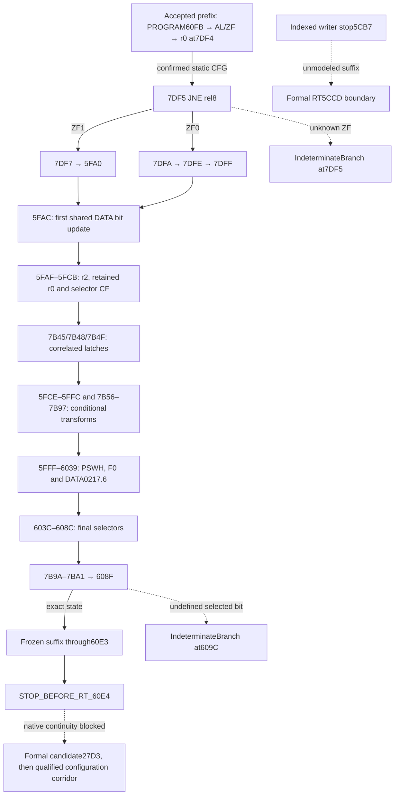

# M2cw — The mode middle corridor

The accepted base is M2cv `150ada6ed6fd66d9d8105f1ac74853b072824249`.
M2cv supplies the frozen `From5F45` prefix up to `7DF5`, the separately
qualified `At608F` suffix, and formal return obligations for `60E4`.
Its accepted suite has 29 tests. The original 28/29 run and correction
from a count of 12 to the exact 13 ordered prefix writes remain in M2cv
evidence. [M2cv source and model](M2CV_ENCLOSING_CALLER_RETURN_PROVENANCE.md)

## Novelty and source boundary

M2cc established the enclosing static graph with 226 nodes and 253 edges.
M2cd supplied frame footprints and a retained-source path filter. M2cv
implemented the entry and suffix fragments. The new work is a source
transformation of the omitted middle, a verified transition through its
actual exit, and exact state transfer into the suffix.

The bounded source inventory has 148 nodes and 171 edges, including the
edge to the exclusive frontier `608F`. Each selected node is bound by
the private retained listing, decoded extent and primary ISA review.
The public inventory exposes forms, lengths, successor relationships,
source proof identities and effect equations. The private proof records
operand identity without including the retained bytes in public fixtures.
The corridor is acyclic with zero nested calls. [Historical frame and clobber proof](M2CD_CAL27D0_RT60E4_FRAME_PROVENANCE.md)



Solid lines summarize confirmed static edges and selected conditional
source blocks. Every reached predicate still requires its declared
input. An unresolved predicate records its source and stops the model
before any successor effect. Dashed lines mark unresolved boundaries,
the unmodeled indexed suffix and unproved native continuity.

## PROGRAM operands and correlated control

`7DF5` is a two-byte JNE. ZF1 falls through to `7DF7` and then
`5FA0`. ZF0 takes `7DFA`, its PROGRAM read and byte shift, and
`7DFF→5FAC`. The reaching ZF is from `5F99` reading PROGRAM60FB,
and the reaching r0 byte is written by `7DF4` from that same AL.

There are 23 LCB sites in the middle with 17 distinct fixed PROGRAM byte
addresses:

```text
60E8 60E9 60EA 60F2 60F3 60FC 60FD 60FE 60FF
6100 6101 6102 6103 7BA4 7BA5 7BA6 7E02
```

The prior PROGRAM60FB identity remains a dependency without a new LCB
at the r0 comparisons. The conditional suffix separately uses PROGRAM6104
and PROGRAM6105 through frozen M2cv.

Each middle read checks exact space, byte width, address, lack of an
index, source proof and generation. A bound symbolic slot can have a
nullable byte or partial bits. If PROGRAM60FB is repeated in the middle
input, its slot must match the prefix value, bits and generation.
The retained proof locates each PROGRAM operand. Supplied values in the
public corpus remain invented software inputs.

Repeated PROGRAM60EA, 60F2, 60F3 and 7BA5 tests reuse their bound
slots. Local r0 comparisons reuse the generation from `7DF4`.
The selector route reads DATA03CF at `5FB2`, writes r2, and derives
the selected CF at `5FCA` when the chosen r0 path uses the r2 value.
On the transform route, `5FBA` SLLB extracts the original bit7,
`5FBC` MOVB retains CF, and `5FBE` RORB restores that carry as r2
bit7. This preserves the DATA03CF.7 dependency on both r2 routes.
The other r0 path selects PROGRAM60FC. At `7B45`, the selected CF
reaches DATA0216.3. At `7B48`, the same held CF determines whether
the path reads PROGRAM7BA6. Both paths store the selected bit in
DATA0227.0 at `7B4F`; `7B9A` tests that retained generation.
These relations are separate from the PSWH carry ambiguity.

## PSWH, state and writer generations

The retained primary PSW/PSWH rule is used conservatively and leaves
CF, ZF and HC undefined. The model records each reviewed XORB PSWH
effect, retains the unrelated fields outside the selected mask, and
carries `None` for the three undefined flags. DATA03C7 feeds r1 and
can contribute a candidate bit to the pre-XOR shift at `6015`.
The source supplies no exact complement relation after `6016`.

At `6019`, MB copies the current CF into PSWL.4 (F0). A reached
`602D` clears F0 and sets ZF from the old bit. `6037` copies the
current F0 to CF, and `6039` writes that value to DATA0217.6.
The later `6063` F0 write changes its own register generation.
These transitions preserve partial knowledge. If the unknown bit
persists to the suffix, the predicate at `609C` can remain unresolved.
Later legitimate shifts, loads, comparisons and bit operations update
their documented flags. They do not retrospectively define the XOR.

The same DATA store backs local registers and pointer aliases.
LRB0041 is required at the corridor entry. The model adds DATA020A
for r2. At the frozen boundary its incoming value and generation are
unknown; `5FB3` supplies the first modeled r2 write. DP uses the
selected word at `0084 + 8*SCB`. No independent pointer value is
introduced. The word's byte footprint follows the selected aligned
address. Unknown SCB stops at the first required pointer-bank effect.

| Source field | Qualified corridor effect |
|---|---|
| AL / A | Written by the selected loads and shifts |
| AH | Retained in the reviewed DD0 byte corridor |
| CF / ZF / HC | Source-defined effects and precise unknowns at logical PSWH writes |
| DD / MIE | Retained under the admitted byte and PSWH mask rules |
| OtherPSW | F0 written and read with separate partial bit knowledge |
| LRB / SCB / USP / SSP / X1 / X2 | Retained under the admitted register and DATA mapping |
| DP | Alias-dependent word write at `5FAF` |
| r0 DATA0208 | Retained generation from `7DF4` |
| r1 DATA0209 | Conditional masked write at `5FA9` |
| r2 DATA020A | First `5FB3` store, with additional conditional shifts and stores |
| DATA0216 / DATA0217 / DATA0227 | Ordered selected bit writes, each with its own generation |

The independent footprint review checked 16 operand write accesses
across all eight SCB choices. Their byte and word footprints exclude
DATA0208 in the admitted mapping. Numerical equality of two bytes
does not establish generation identity. Same-value stores still
produce distinct journal events. DATA0356.1 remains untouched in
this middle and receives its qualified write in the frozen mode tail.

## Pure functions and composition contract

`mode_middle_corridor` requires a full typed M2cv prefix result, its
original query and the reviewed source binding. It compares the full
supplied prefix with the exact frozen result, including the journal,
intermediate state and r0 generation. A missing operand, conflicting
generation, forged boundary or unresolved predicate produces the
bounded refusal. A successful corridor returns at `608F` after the
explicit edge `7BA1→608F`.

`mode_enclosing_continuation` applies the accepted prefix, transfers
the returned state to the middle, and admits the suffix after the
verified exit at `608F`. It retains each accepted child output in
full. A direct call to the original same-name wrapper collided with
its retained prefix writer namespace in the pre-freeze review. The
adapter uses the frozen suffix body and its guards with a separate
namespace for new suffix events. Prefix and middle generations keep
their original identities. There is no AL/CF/ZF/DD/LRB/r0 reseed.

```text
prefix = accepted_from_5f45(original_inputs)
if prefix did not complete before 7DF5: return prefix and its refusal

state = exact_returned_state(prefix)
require byte context, LRB0041, applicable DATA and no interference
require bound PROGRAM60FB generation
if ZF is unknown: stop at 7DF5
select the 7DF7 or 7DFA block using that ZF
apply its exact PROGRAM loads, shifts and bit write at 5FAC

DP = selected_bank_word(03CF); r2 = DATA[DP]
apply the correlated PROGRAM60EA r2-transform branch
derive CF from r2 or PROGRAM60FC through the selected r0 path
write DATA0216.3; branch on that same CF; write DATA0227.0
apply selected PROGRAM and local-byte effects in the 5FCE/7B blocks
apply the selected 5FFF–6039 F0 and PSWH dataflow
apply the 603C–608C selector effects
test the retained DATA0227.0 generation, write DATA0227.2
take the confirmed 7BA1 → 608F edge

if any required premise or predicate was unresolved: return exact prefix
suffix = accepted_at_608f_body(state, distinct_suffix_writer_namespace)
return all nested outputs, ordered effects and exact suffix stop
```

Each block in the implementation has source-specific transformations
and verifies consecutive successors against the bounded inventory.
No target execution engine, opcode stream or host-selected target is
part of this algorithm.

## Historical path count and optional frontiers

The independent source-only check reproduced the M2cd retained-source
filter: 24 fixed zero predicates reduced the whole-procedure synthetic
path count to 16, the shared carry relation reduced it to 8, and the
derived DATA0227.0 relation reduced it to 4. The two `609C` outcomes
remain in that conservative proof. Its middle projections have 93 or
95 source nodes. The unconstrained bounded CFG has 466,560 syntactic
paths of 77 to 121 source nodes. Neither count is a CPU execution
count or a required number of results for the symbolic fixture domain.

The optional indexed source audit retained the straight-line
`5CB7–5CCB` inventory and normal RT5CCD frontier. The first load
at `5CB7` needs a qualified DATA00FA shadow generation. Its
documented word load sets DD1/ZF and retains CF/HC. The next step,
`5CB9`, is an IE store. Later P2/TM2 provenance, PSWH flags and
the return frame require independent qualification. The reviewed
off-page word at `5CC2` has offsets 5A/5B and cannot overlap
DATA03CB under an aligned page. The frozen indexed writer keeps
its boundary before `5CB7`.

The mode-to-configuration result adds one source implication:
the middle preserves r0, LRB/SCB and DATA0356.1, then the frozen
suffix generates the selected bit1 writer. Transfer of that generation
through formal `60E4→27D3` and the M2cv configuration corridor
still depends on matching frames, path predicates and alias exclusion.

## Verification and delivery

The independent oracle uses a separately authored bounded decision
evaluator and frozen M2cv references. Its canonical stream is frozen
before the first implementation comparison. Cases cover known and
unknown branches, partial PROGRAM operands, mismatched source or
generation, forged prefix state, PSWH ambiguity, same-value writes,
selected DP banks and suffix namespace collision. The routing tests
exercise the finite static lane and the full historical fallback.

The independent freeze covers all 148 corridor nodes and 171 edges
across invented fixtures. Its 86 records contain 56,294,160 bytes
with SHA-256 `fd220e49df7dc747f2252240a4399d2a0aaec2a5de5409a9b456238ee29685b4`.
The first implementation comparison matched all 86 records.

Canonical evidence compares all decompressed expected, local, Ubuntu
and Windows bytes to EOF, with exact IDs, complete nested outputs and
zero field exclusions. Final counts, digest, actual jobs and source
binding equality are recorded in the private report. The scoped audit
retains seven inherited preservation exceptions and the foreign files.
The historical workflow tail remains byte-exact.

The boundaries are before RT60E4, RT5CCD, DATA4700 read2891, BRK3FB5,
IE write3FF9 and STBUF2995. Native frames, physical memory and actual
peripheral applicability remain unresolved. The proposed M2cx scope
is the first independent indexed suffix gap at DATA00FA and its
separately qualified IE policy, followed by a concrete frame/generation
proof for mode-to-configuration if the required evidence is available.

`EXECUTION_BLOCKED` · `FirmwareReady=false` · `STOP_BEFORE_STBUF_2995`.
