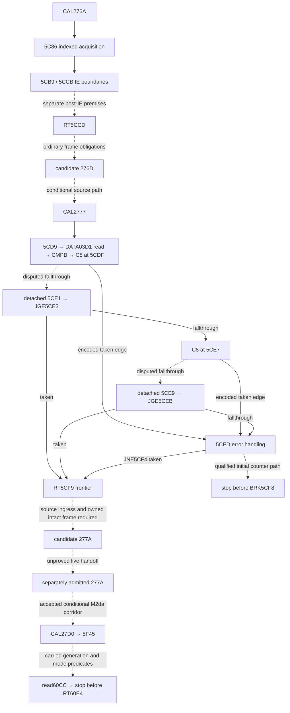

# M2db helper ingress, ordinary frames, and DATA03CB lineage

M2db starts at accepted M2da `927bbb4cd360aeee11171cca1651380621b6c927`.
M2da established an independently admitted `277A` window through the mode
read at `60CC`. M2db examines the earlier edges that would be required
to reach that window from the full helper. The detached M2da result is unchanged.
[M2da source analysis](M2DA_C8_NORMAL_HELPER_CONTINUITY.md) ·
[Accepted M2da CI](https://github.com/Pvitaly91/HondaEcu/actions/runs/42482450461)

Solid edges are reviewed static CFG or the separately qualified fault prefix.
Dotted edges need distinct premises. The encoded ordinary RT candidates
remain formal. IE and STBUF are blocked at their established boundaries.

| Boundary | Evidence class | Limitation |
| --- | --- | --- |
| CAL target and decoded helper edges | ConfirmedStaticCFG | Encoded control flow does not bind a live state |
| DATA03D1 and first-call fault | ConditionalSourcePath | Index-3 and counter generations must agree |
| 5CE1 and 5CE9 | DetachedEntry | No confirmed independent incoming edge |
| 5CDF and 5CE7 | PrimarySourceConflict | Printed OR and comparative AND retained |
| 5CCD, 5CF9, 60E4 | FormalReturnCandidate | Expected word geometry is conditional |
| Formal frame words | UnknownFrameOwner | Matching bytes alone cannot establish ownership |
| Competing DATA03CB writes | UnexcludedWriter | Unknown pointer, generation, or interference withholds retention |
| IE5CB9, IE5CCB and STBUF2995 | HardwareBlocked | No device state or execution authority |

## C8 evidence and new ingress exclusions

The new evidence review found no authenticated correction applicable to
MSM66201 C8, so `C8_PRIMARY_CONFLICT_UNRESOLVED` remains. M2da's direct-edge
review is carried forward without another enumeration. M2db checks the
eight reviewed VCAL vector words and the intact ordinary CAL or VCAL
return candidate at each detached boundary. No reviewed vector targets
either boundary. The predecessor ending at each boundary is C8, so it
cannot create an ordinary return word for that boundary. Unbound
indirect transfers and unproved stack state remain outside those exclusions.

The source model keeps branch observations correlated across the same
prefix and across one interpretation at a time. For example, equality
at the first C8 forces the preceding-to-JGE carried value into the first
JGE taken class under the comparative reading. A later second-C8
observation cannot be joined to that prefix simply because both
observations are feasible individually. Only reviewed abstract relations
are published.

## Formal return lifetime and competing writes

The frame model separates `CAL276A`, `CAL2777` and `CAL27D0`.
It checks creator, expected return word, aligned SSP address, memory
applicability, ordered interference, nesting balance and generation
at the return boundary. A slot can be reused by a subsequent lifetime
with a distinct generation. Both indexed IE boundaries must be handled
as separate software premises. No software premise advances hardware IE.
The model keeps the helper's detached normal frontier and the missing
source handoff to `277A` visible even when the formal geometry agrees.

`5CF4` provides another encoded route to `5CF9`. The accepted
first-call F7 generation and qualified decrement produce the BRK frontier.
A frame mapped over F6/F7 changes the counter's reaching definition.
If the error update then writes that live frame's high byte, either
documented counter interpretation changes the saved word. A taken JNE in
that hypothetical case cannot certify the expected return.

The lineage model separates the helper body's write footprint from its
ordinary frame and other possible acquisitions. In a qualified mapping,
the local helper writes are disjoint from DATA03CB. An aligned frame at
03CA or a later index-5 acquisition replaces its generation, including
when the byte value agrees. An index-3 acquisition instead affects the
DATA03D1 read. A frame at 03D0 can replace that generation. The caller's
USP-relative writer remains a separate obligation. For `USP=0419` its
effective address is 03CB. M2da's detached proof remains the available
source-to-60CC result.

## Verification and next boundary

The corpus uses invented inputs and independently specified expected
records. It retains complete conditional outcomes and refusal records.
The finite CI lane requires the exact reviewed source set and approved
workflow projection. Other changes route to historical QA. No private
ROM bytes, operands, or execution traces are needed to run it.

The supported classification is `PARTIAL_HELPER_HANDOFF_RECONSTRUCTION`.
A specific next investigation would bind the target MCU revision to an
applicable primary C8 clarification. Without it, the full helper's
normal ingress and return handoff remain unresolved.
`EXECUTION_BLOCKED`, `FirmwareReady=false` and
`STOP_BEFORE_STBUF_2995` still apply.
