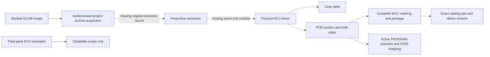
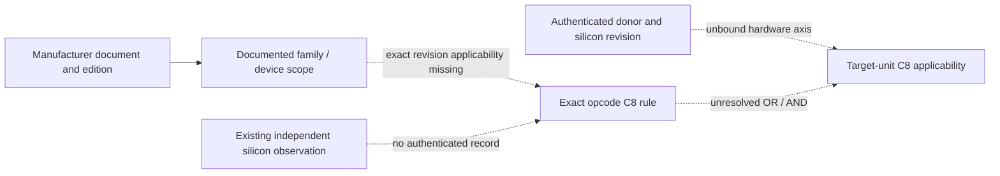

# M2dc target MCU, ROM custody, and exact C8 applicability

## 1. Accepted baseline and novelty preflight

Accepted M2db `711896d8c89e14ce4f2c7fada675fa4aa5f80426` retained both C8
interpretations and the unresolved full-helper entry. The detached M2da
`277A` proof remains in its original scope. M2cm had already established
project archive provenance and the candidate memory matrix. M2am had already
classified the conflicting manufacturer text, the unrelated opcode, and the
unsent inquiry. None of those findings is counted as a new observation.
[M2db CI](https://github.com/Pvitaly91/HondaEcu/actions/runs/42489144266) ·
[M2db source review](M2DB_HELPER_INGRESS_FRAME_HANDOFF.md) ·
[M2am evidence](M2AM_C8_EQUALITY_EVIDENCE.md)

The new review targets original extraction custody and distinct 207-specific
manufacturer documentation. It avoids another CFG traversal, mirror census,
or read of the ROM payload. Secondary ECU examples can refine documentary
scope and motivate conditional checks. The candidate set would only narrow
if a source proved an exclusive contradiction under a stated memory premise.
Unresolved source edges remain explicit in the executable evidence graph.

## 2. M2cm baseline and studied ROM acquisition

M2cm binds all 32,768 bytes to the recorded acquisition from a pinned public
archive. The inherited historical attachment describes an upload and leaves
the origin unknown. Import, deduplication, and matching bytes establish facts
about archive lineage. They supply no physical extraction date, donor,
factory-original status, or active device configuration. No new ROM payload
was acquired.
[M2cm provenance](M2CM_ECU_ROM_PROVENANCE_BRIDGE.md) ·
[M1a acquisition findings](M1A_REAL_ROM_FINDINGS.md)

## 3. Prearchive gap and same-unit graph



The first absent link is between project archive acquisition and original
physical extraction. The next links require a stable donor identifier,
matching bytes, documented custody, and the label, PCB, and marking from
that same subject. Later observations cannot stand in for the first link.
The provenance evaluator distinguishes documentary dependence, separate
subjects, and mutually exclusive claims about one subject. Invented
same-subject fixtures evaluate the conflict policy only.

## 4. ECU, PCB, and literal MCU candidates

| Subject scope | ECU label | PCB | Literal marking | Bound to studied donor |
| --- | --- | --- | --- | --- |
| Retained seller example | P28-A01 | 1720 | M66207-251 | No |
| Retained shop example | P28-A02 | 11F0 | M66207-304 | No |
| Shop catalogue association | A01/A51 and A02/A52 | Unbound | Code associations | No |
| Studied ROM donor | Unknown | Unknown | Unknown | Unestablished |

The Bomarc drawing has its own documentary scope. Neither a visible socket
nor an optional EPROM on a drawing establishes active external PROGRAM
selection. A visible ASIC gives no internal MCU or electrical net identity.
Modified boards can carry software different from the case or chip label.
Different physical examples and nonexclusive shop associations can coexist.
Only incompatible claims about the same authenticated unit are a same-unit
conflict. Dependent catalogue and schematic copies are counted once per
evidence lineage.

## 5. Catalog part, code number, and silicon revision

MSM66201, MSM66207, MSM66P201, and MSM66P207 remain the standard candidates.
Documentary family and program-technology relationships do not authenticate
the literal `M66207` abbreviation as a manufacturer alias. The generic
ordering field for a code number and separate package designators do not
decode `251` or `304` into a customer, mask, or stepping.
`CustomerCodeSemanticsUnestablished` remains applicable to those literal
suffixes. A revision match requires authenticated markings and a
manufacturer mapping that applies to that device.

## 6. PROGRAM architecture, DATA, and board selection

The overlay preserves all 60 rows of the M2cm matrix. It checks each address
span against the documented candidate map and compares overlaps within the
same address space. A 32-KiB image exceeds the internal-only 16-KiB premise
of standard 201. Standard 207 has a 32-KiB internal PROGRAM capacity.
External PROGRAM remains a conditional alternative. OTP rows retain separate
configuration obligations. These are premise-level results.

The Y4 device specification describes EA, the PROGRAM read strobe, and
separate DATA strobes. A generic electrical rule does not prove a board's
active selector, device population, decode or overlays. A DATA span can
require external mapping independently of PROGRAM. A candidate RAM range
does not establish live stack ownership or safe IE/IRQ handling.
[M2cl device and memory review](M2CL_ACTUAL_ECU_SILICON_APPLICABILITY.md)

## 7. C8 primary evidence and applicability

The September 1991 MSM66201 manual is one textual witness for the printed
OR rule. The conflicting comparative AND rule and the unrelated nX-8/500S
opcode retain their separate scopes. The 1998 joint instruction list gives
the generic JC mnemonic. Two URLs for the same edition count as one witness.

A new page-level review of the already preserved preliminary MSM66207 /
MSM66P207 document found explicit greater-than wording for JC GT on p31.
That row supplies neither an opcode nor a CF/ZF predicate. The first-edition
November 1990 mark is on the electrical table. It does not identify a target
silicon revision. The archive filename's suffix supplies no manufacturer
alias or code mapping. This review adds exact-part mnemonic wording and
leaves the OR/AND conflict unresolved.
[Preliminary OKI 207/P207 document](https://datasheet.octopart.com/M66207-309-Oki-Semiconductor-datasheet-12614073.pdf)
The source-specific equal/lower helper domain does not gain a consensus
fallthrough from synthetic greater-case agreement.



The joint result requires both axes and a match at the same revision.
Textual applicability, a manufacturer statement about produced silicon,
and independent physical observation are separate evidence classes. The
last class requires existing authenticated observation of exact C8, native
CMP flags, and actual branch successors in the distinguishing equality
and lower cases. Emulator results and host-selected flags remain outside
that class.

## 8. Inquiry, source search, and next evidence

The M2am inquiry remains `InquiryDraftReady / NotSent`. The compatible
silicon protocol remains `ProtocolReady / NotExecuted`. No new vendor
response or contact is claimed. Applicable revision-specific clarification
would address the ISA axis even while donor custody remains open.

The targeted custody search found only public archive and schematic
derivatives, generalized extraction descriptions, and publication metadata.
The separate revision search did not find applicable errata, an authentic
manufacturer reply, or an independent exact-part C8 observation. One known
databook lead remained inaccessible and was kept at index-only scope.

The minimum documentary packet pairs an original extraction record
and exact byte binding with the same ECU's label, both PCB sides, readable
marking, and existing PROGRAM device/selection records. It also needs an
applicable manufacturer part/revision identification and exact C8
clarification or independently authenticated existing silicon evidence.
Each item needs its subject, custody, file identity, and uncertainty.
The narrow next target is the original prearchive extraction record with a
stable same-unit donor link. No physical operations are within this scope.

## 9. Pure interfaces, oracle, and delivery

The package implements documentary provenance and witness deduplication,
candidate attribution, PROGRAM/DATA premise checks, code and revision
adjudication, exact C8 evidence qualification, and the target-unit proof
graph. These are portable evidence checks.

```text
recorded_archive = authenticate_project_record(source_ids, byte_binding)
donor = require_original_extraction_with_same_unit_custody(recorded_archive)
silicon = require_exact_marking_and_applicable_revision_mapping(donor)
rule = require_exact_c8_revision_evidence(independent_manufacturer_sources)
return qualify_junction_only_when_both_axes_bind_same_revision(silicon, rule)
```

The independent oracle freezes full records before first comparison.
The corpus retains refusals, unknowns, conditional candidates, and
synthetic controls without promoting them to hardware observations.
The exact finite CI lane checks immutable source bindings, full canonical
records, and the approved workflow overlay. Unrecognized changes use the
historical QA path. The delivery receipt records actual test totals,
byte equality to EOF, privacy surfaces, and preservation results.

The evidence keeps `TARGET_MCU_C8_APPLICABILITY_UNRESOLVED`,
`EXECUTION_BLOCKED`, `FirmwareReady=false`, and `STOP_BEFORE_STBUF_2995`.
