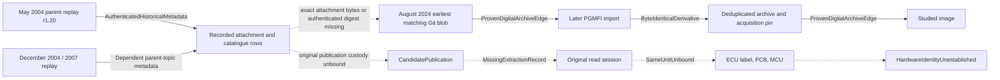

# M2dd prearchive extraction custody and historical publication evidence

## Accepted baseline and novelty

Accepted M2dc `b8227cacfde2b588b8abe3a64be9ff5518e50a03` retained
the M2cm project acquisition and identified the first missing link to
physical extraction. M2dd investigates the recorded parent topic and
earlier Git ancestry. It does not repeat the candidate ECU photo or C8
searches. The attachment record, date, later archive import and dedup
were previously known. Verified replay bodies and earlier matching Git
trees provide the new evidence.
[M2dc CI](https://github.com/Pvitaly91/HondaEcu/actions/runs/42494726636) ·
[M2cm provenance](M2CM_ECU_ROM_PROVENANCE_BRIDGE.md) ·
[M2dc documentary scope](M2DC_TARGET_MCU_C8_APPLICABILITY.md)

## Studied image and earliest exact Git artifact

The admitted image is 32,768 bytes. The M1a and M2cm dossiers bind its
recorded project acquisition to a pinned archive and to the admitted
bytes. The older acquisition script supplied several HTTP metadata
fields as literals. The accepted dossier retains its narrower scope.
No new ROM payload was needed for this review.
[M1a acquisition findings](M1A_REAL_ROM_FINDINGS.md)

The reviewed ancestry of the direct parent of the known import has 19
commits with complete tree metadata. The first five snapshots have no
matching entry. The sixth, on 2024-08-10 at 22:29:55 UTC, has two
32,768-byte entries with the same archived blob in the Crome collection.
The later import on 2024-08-11 at 03:29:47 UTC adds a matching PGMFI
collection entry. The December dedup removes two entries and renames
one. The remaining blob matches the accepted acquisition pin.
This is earliest exact archived-blob presence within the reviewed Git
ancestry. Commit and tree metadata do not establish pre-Git copying
direction, date of first publication, or an extraction event.
[Earliest matching Git tree](https://github.com/hondabase/files-archive/commit/8db2006a08bfc157911d6c4dfca7be6db9a7bc58) ·
[Later import](https://github.com/hondabase/files-archive/commit/e9dbf236b814e5abb203069d09071880474475d9) ·
[Deduplication](https://github.com/hondabase/files-archive/commit/0fcca91f1124672b7b756118d9fd5d701102eefc)

## Attachment and parent publication context

The earliest authenticated replay in the bounded 2003–2004 exact-topic
index is 2004-05-22 at 16:20:12 UTC. It contains parent revision r1.20,
dated 2004-05-21 at 23:35 GMT, and the focal attachment row. The row records
19 February 2004 at 19:35, with no timezone. It lists the recorded size,
a contributor alias, and an explicit unknown-origin description.
The alias is retained privately as metadata with no attribution to an
extraction operator. No numerical attachment ID or prior file revision
identity was authenticated.

A separate row in the same topic associates the linked filename with
P28-A01 at catalogue scope. The two rows share one publication context.
The December 2004 r1.37 replay and the 2007 r1.84 replay corroborate the
retained row. The retrieved revision-history view adds page context.
None provides the attachment payload's full byte identity, an original
publication timestamp, a direct link to the Git blob, or a donor.
Archive capture, rendered revision, claimed upload, and physical
extraction are distinct events. Complete body identities, the bounded
index, and source access outcomes are kept in the private audit.

## Dependency graph and proof status



The replay authenticates publication metadata by the capture date.
Repeated copies of that topic share the metadata lineage. The three Git
paths share one blob lineage. A separate archived timestamp or a copy
with matching content is not a separate physical-extraction witness.
No reviewed source asserts a conflicting authenticated same-unit donor.
Publication presence and byte equality address different edges. The
attachment-to-blob edge remains unproved.

## Extraction, hardware, and originality

No primary read-session record identifies an operator, stable donor,
method, selected memory, or complete output bound to the studied image.
An internal MCU read, external ROM read, modified memory, a copied
calibration, and a repacked payload remain separate possibilities.
The original physical origin and factory originality remain unknown.
The M2cm/M2dc ECU, PCB, and MCU candidate sets are preserved. Third-party
photos and catalogue rows cannot populate same-unit links. A known MCU
marking would still need its own applicable revision evidence for C8.

## Static checks and portable logic

Seven pure interfaces check archived lineage, attachment provenance,
copy dependence, artifact identity, chronology, extraction-session
provenance, and same-unit donor binding. They enforce explicit source
roles, subject joins and complete image evidence. Invented controls
exercise valid and refused custody shapes without adding actual facts.
Weak hash, equal size, filename and unavailable sources remain separate
identity classes. UTC ordering is evaluated only for comparable known
times. An unknown timezone or date-only event remains unresolved at the
exact instant level. Even a consistent timeline grants no provenance.

```text
historical = qualify_snapshot_and_attachment_metadata(source)
digital = match_archived_blob_and_studied_image(pinned_sources)
require_exact_attachment_binding_to_join(historical, digital)
require_authentic_read_record_with_exact_image_and_stable_unit()
join_unit_to_board_to_marking_only_with_same_subject_custody()
```

The independent oracle freezes complete expected records before any model
comparison. Domain cases retain conflicts, unknowns and refusals.
They reject upload/import dates as extraction times, archive checksums
as factory evidence, duplicate witnesses, mismatched subjects and
execution claims. Exact source bindings and finite CI routing preserve
the historical fallback. The private delivery record contains the
actual QA totals, complete byte comparison, privacy and preservation
audits. Public results use opaque source identifiers and redacted metadata.

## Missing proof and next stage

The immediate source request is a contemporaneous extraction record with
the full image or its authenticated complete digest and a stable same-unit
donor link. A preserved copy of the old attachment with verified full
identity could close the digital edge independently. Existing label,
PCB and MCU documents matter when their custody links them to that donor.
The narrow M2de scope is to qualify such existing primary evidence if
available. The verdict is `HISTORICAL_ATTACHMENT_PROVENANCE_QUALIFIED`.
C8 remains unresolved. `EXECUTION_BLOCKED`, `FirmwareReady=false`,
and `STOP_BEFORE_STBUF_2995` remain in force.
