# M2de original attachment recovery and extraction evidence

## Accepted baseline and novelty

M2de starts from M2dd `3c8ef7b1347816c22a15ec1c79c0a54986dcec43`.
M2dd authenticated the parent-page metadata and the exact 2024 Git blob.
It left the historical payload and the physical read session unbound.
M2de follows the attachment URL from the authenticated pages to
archived binary captures. The previous topic and Git ancestry scans
remain the accepted baseline.
[M2dd scope](M2DD_PREARCHIVE_EXTRACTION_CUSTODY.md) ·
[M2dd CI](https://github.com/Pvitaly91/HondaEcu/actions/runs/42501508906)

## Historical record and actual payload recovery

The May 22, 2004 parent replay, revision r1.20, records the attachment
and a February 19 upload time with unknown timezone. Its origin is listed
as unknown. The catalogue row naming P28-A01 is separate.
The three authenticated parent views resolve to one binary subject.

The exact binary archive index returned four successful capture records
with one archive-recorded content digest. Two unrewritten binary replays
were retrieved with the exact linked subject and verified Memento times.

| Source ID | Verified capture UTC | Full length | Comparison with admitted image |
| --- | --- | ---: | --- |
| HistoricalCaptureJune2004 | 2004-06-17 08:30:20 | 32,768 bytes | Equal to EOF |
| HistoricalCaptureSeptember2004 | 2004-09-01 20:57:27 | 32,768 bytes | Equal to EOF |

Each replay returned HTTP 200, the expected capture identity and full
payload without redirects. The private readback checked the archive
digest, complete bytes against both admitted copies, and the pinned
Git blob identity. The admitted sources remained unchanged. The result
binds the recovered historical captures. The exact version present at
the recorded February upload remains unknown.
[Historical parent replay](https://web.archive.org/web/20040522162012/http://www.pgmfi.org:80/twiki/bin/view/Library/EcuDefinitionCodes) ·
[Earliest matching Git tree in M2dd](https://github.com/hondabase/files-archive/commit/8db2006a08bfc157911d6c4dfca7be6db9a7bc58)

## Digest provenance, dependency and chronology

The archive digest validates replay content. Its provenance is the
archive capture. A digest calculated from the later Git copy confirms
that copy. Neither supplies a contemporaneous contributor digest
authenticated independently of the capture and the Git archive.
The digital proof rests on complete byte comparison.

The two binary captures and parent metadata belong to the same
historical publication lineage. The 2024 Crome and PGMFI Git paths
belong to the accepted blob lineage. Replays and deduplicated paths do
not supply additional physical-extraction witnesses. Upload metadata,
parent revision, archive captures, Git commit and project acquisition
remain distinct. The local comparison verifies content identity.
It establishes neither pre-Git copying direction nor the date of first
publication or physical extraction.

```mermaid
flowchart LR
    P["2004 parent metadata"] -->|exact historical attachment subject| C["June and September binary captures"]
    C -->|full 32768-byte equality| G["Pinned 2024 Git blob"]
    G -->|accepted project acquisition| R["Studied image"]
    R -. "contemporaneous output binding missing" .-> E["Original read session"]
    E -. "stable same-unit custody missing" .-> U["Physical ECU and PCB"]
    U -. "marking / revision unestablished" .-> M["Applicable MCU identity"]
```



## Extraction custody, donor and originality

The targeted local and historical source review looked for a full
original digest, companion extraction log and a scoped original
submission record. The retained topic and revision diff, specific
forum metadata routes and local archive index yielded none. This
conclusion is limited to the reviewed records.

Original extraction method, ECU label, PCB, MCU, silicon revision,
active PROGRAM selection and factory originality remain unestablished.
An independently authenticated read session and exact output binding
would supply the physical edge. A separate applicable source is still
required to resolve C8/JGT for a particular revision.

## Models, independent oracle and QA

Four new pure interfaces qualify the historical payload, the digest
origin, the attachment-to-blob join and the combined two-axis status.
The combined status reuses frozen M2dd extraction and chronology logic.
Accepted actual edges and invented fixture edges remain separate.

```text
bind historical subject and archive capture
require complete byte equality or an authenticated original full digest
refuse conflicting, transformed, or misattributed evidence
evaluate physical read custody as an independent proof
```

The independent oracle freezes complete records before model comparison.
The corpus covers both verified captures, derivative and partial identity,
original versus copied or archive-generated digests, different payloads,
wrong subjects, dependency duplicates and missing ECU custody. Refusals
remain in the stream. The source fence and finite CI route keep inherited
source identities and the historical fallback intact.

The exact replay bodies, private digests, source links and raw evidence
are retained privately. Public records carry only approved source IDs,
redacted proof facts and immutable zero execution authority. The private
delivery record includes actual local and CI results, complete canonical
byte comparison, privacy audit, and preservation checks.

## Verdict and next evidence

`ORIGINAL_ATTACHMENT_BYTE_IDENTITY_ESTABLISHED` for the two verified
historical captures. The next physical proof is an existing contemporaneous
read-session record binding the full image to a stable donor. No hardware
observation or execution follows from the digital proof.

A separate software-only M2df could model response-byte selection and
checksum accumulation from the alternate parser branch at `0227`.
The candidate bound includes `[0227,023E)` and the six reviewed sites
at `024C–0253`, with stops before STBUF at `023E` and the epilogue at
`0244`. A new source audit must qualify PROGRAM-to-DATA addressing and
refuse unbound or possible SFR reads. This scope has no C8 dependency
and can use an independent branch table and byte-arithmetic oracle.

`EXECUTION_BLOCKED`, `FirmwareReady=false`, and `STOP_BEFORE_STBUF_2995`.
