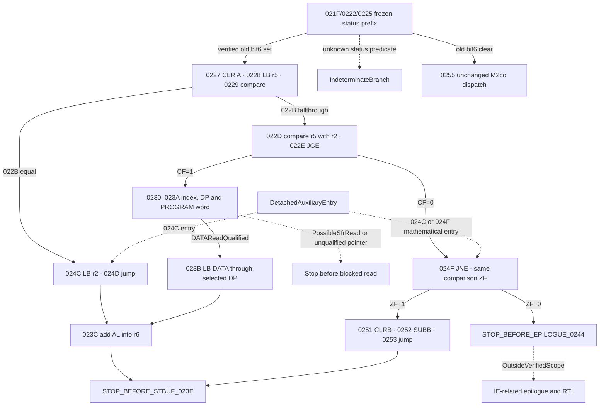

# M2df alternate parser response selection and checksum

## Accepted baseline and novelty

The accepted M2de commit is `a506695829abf63ba43e12e53c7b9a569ff7f81f`.
The ROM's digital identity is established and its physical donor remains
unknown. M2co already models the ordinary parser dispatch and its own
checksum. M2co and M2cp retain the old status bit-6 path as a stop at
`0227`. M2ch and M2cq inventory adjacent alternative effects and the
epilogue. M2df reconstructs the response branch between those boundaries.
[M2de CI](https://github.com/Pvitaly91/HondaEcu/actions/runs/42508518112) ·
[M2co parser contract](M2CO_LENGTH_CHECKSUM_DATAFLOW_RECONSTRUCTION.md)

## Exact source inventory and CFG

The redacted inventory binds 15 sites in `[0227,023E)`, six auxiliary
sites, and two stop-before instruction identities. The read-only source
review checks admitted bytes, listing and instruction extents. The public
inventory contains reviewed forms, widths, PC edges and effect equations.
The selected CFG has no C8, CAL, VCAL, RT or RTI in its active scope.



Solid arrows denote confirmed static edges or their indicated conditional
predicates. The hard boundaries admit no instruction effect at their PC.

## Response selection and checksum equations

| Predicate | Response and source effect | Boundary |
| --- | --- | --- |
| `r5 == 2` at 022B | Load AL from r2 at 024C. Add AL into r6 at 023C | 023E |
| `r5 != 2` and unsigned `r5 < r2` | Select AL via the indexed PROGRAM word and qualified DATA byte. Add AL into r6 at 023C | 023E or exact earlier block |
| `r5 != 2` and `r5 == r2` | Clear AL and subtract current r6 at 0252. Preserve r6 | 023E |
| `r5 != 2` and unsigned `r5 > r2` | Same CMPB yields CF0 and ZF0. JNE takes the epilogue edge | 0244 |

`023C` writes `r6 = (r6 + AL) mod 256` and retains AL. `0252`
forms `AL = (0 - r6) mod 256` after 0251, bypasses 023C, and has no
r6 write. ADD sets carry for unsigned overflow and HC for low-nibble
carry. SUB sets CF and HC for unsigned byte and nibble borrow. Both
set ZF from their byte result. DD is retained by these arithmetic forms.
CLR establishes A=0 and DD1, while CLRB establishes AL=0 and DD0 and
retains AH. Compare changes CF/ZF. SLL changes CF only. Unknown values
remain unknown and branch selection needs a proven predicate.

## PROGRAM and DATA, DP aliases and read guards

The index is `(r5 + r3) mod 256`. The direct word at 0231 is the
architectural A alias at DATA0006/0007. It reloads the accumulator and
sets DD1/ZF. The shift and word add form
`PROGRAM address = 6E12 + 2 * index`. The DP backing word is
`DATA(0084 + 8 * SCB)`. The first MOV writes the PROGRAM table address.
`LC A,[DP]` consumes a qualified little-endian PROGRAM word, updates ZF,
and preserves CF/HC/DD. The second MOV puts that word into the same
DP backing slot. LB at 023B reads a DATA byte at the exact resulting
address, including an odd address. The architectural spaces remain
separate even when their numeric addresses agree.

The private static table scan covers 256 word indices and 160 distinct
pointer values. It classifies 15 index results as potential SFR or
reserved low addresses, 2 as pointing-bank storage, 19 as standard
internal RAM under both candidate maps, 117 as internal under the
207 map only, and 103 as external under both. The counts describe the
static address domain. They do not establish native reachability or
which MCU is installed. Symbolic test pointers exercise write-only
and read-sensitive refusal paths without making claims about actual
table entries.

An explicit conditional DATA map and source generation are needed for
ordinary DATA or pointing-bank storage. A missing address, ambiguous
external mapping, write-only register or possible side effect withholds
the dependent read. The local rN slots are DATA03F0–03F7 under LRB007E.
Any dynamic alias into those slots uses the same state and generation.

## Ordered writes and parser composition

The composed path uses the actual frozen M2co output state at 0227.
The caller supplies the generation for the old status byte. The handoff
checks the 0222 RMW, its new generation and the 0225 fallthrough. An
unresolved status predicate preserves the frozen prefix. The unchanged
ordinary dispatcher stays at its accepted boundaries. Composition does
not reseed the state or the accumulator.

The table path preserves two distinct DP word stores and the later r6
byte RMW. The r2 path has only the r6 byte RMW. Equal and greater length
do not write r6. An equal-value write still creates a new generation.
Store history is bookkeeping. It does not add a functional read.

## STBUF, epilogue and auxiliary entry

The source form at `023E` is STB from AL to direct DATA0051, the
documented STBUF address in the standard mapping. The model emits a
candidate AL and prospective intent at the boundary. The target MCU,
peripheral mapping, UART transfer, TX READY and completion remain
unestablished. The separate inherited `STOP_BEFORE_STBUF_2995` remains.

The greater-length route stops before the word load at `0244`.
The remaining epilogue includes IE-related state and RTI outside this
scope. The 024C and 024F auxiliary entries have their own mathematical
preconditions. Neither is reached by simulating STBUF or the epilogue.

## Portable model and verification

The six pure functions cover the main response selector, auxiliary
entry, frozen-prefix composition, PROGRAM-to-DATA qualification, DATA
read obligations and the two checksum equations.

```text
retain frozen status state and verify 0225 fallthrough generation
branch on reviewed equality and unsigned compare flags
if table path:
    store selected DP, bind PROGRAM word, store selected DP again
    qualify DATA read before loading AL
if response accumulation: write modulo256 r6 with fresh generation
if equal length: compute the separate AL subtraction
stop before STBUF023E, epilogue0244, or first unproved operation
```

The independent oracle freezes full records before comparison and retains
unresolved and refused cases. Tests check arithmetic, flags, target
edges, generations, pointer aliases, PROGRAM/DATA separation and the two
hard stops. Canonical output captures ordered effects rather than retired
CPU instructions. The source guard preserves the historical CI fallback,
and the private delivery record contains exact test and artifact receipts,
preservation and privacy checks.

The next independent software-only target is a detached audit of
`0240–0241`, with explicit input-state premises and a stop at the
next verified boundary before any epilogue effect. It requires no
observed STBUF write or native reentry proof.

`EXECUTION_BLOCKED`, `FirmwareReady=false`, and
`STOP_BEFORE_STBUF_2995` remain in force.
