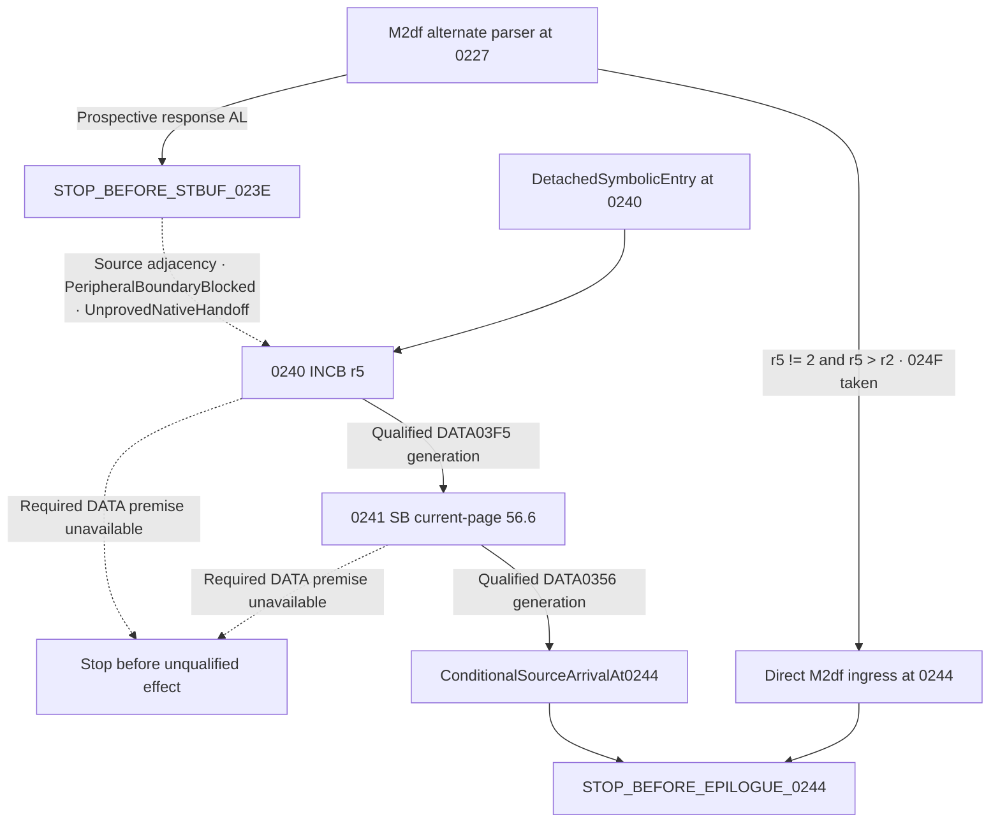

# M2dg — detached post-STBUF continuation at 0240–0241

## Accepted base and new scope

M2df established the alternate parser response and checksum up to
`STOP_BEFORE_STBUF_023E` or `STOP_BEFORE_EPILOGUE_0244`. Its accepted
commit is `a9eeb45292a120711bb1adf918385675c2456409`.
[M2df source model](M2DF_ALTERNATE_PARSER_RESPONSE_CHECKSUM.md) ·
[M2df exact-SHA CI](https://github.com/Pvitaly91/HondaEcu/actions/runs/42517031771)

M2ch previously identified a possible local writer at 0240 and a status-bit
writer at 0241. M2dg verifies their extents and reconstructs their effects on
the counter, status byte, and flags. It keeps the accepted M2co parser prefix,
M2df selector and checksum, M2cq return-tail scope, and M2cs/M2ct peripheral
contracts separate.

## Exact source inventory and CFG

The admitted ROM and retained listing agree on both instruction starts and
the next boundary. The redacted inventory records the forms, operand
classes, widths, extents, edges, and frame conditions. The referenced ISA is
the September 1991 OKI MSM66201 Instruction Manual. The nominal RAM ranges
come from OKI device documentation E2E1027-27-Y4. The source review retains
the unredacted verification privately.
[Redacted source inventory](../research/p28-word0196/detached_post_stbuf_0240_0241/source_inventory.json)

| PC | Form and operand width | Length | End exclusive | Scope and source effect |
| --- | --- | ---: | --- | --- |
| 023E | `STB A,N8`, byte, requires DD0 | 2 | 0240 | Hard barrier. Prospective AL store to DATA0051, documented as STBUF in the standard map. ISA 3-155 |
| 0240 | `INCB r5`, byte, DD-independent | 1 | 0241 | Read-modify-write r5. Update ZF and HC. ISA 3-61 |
| 0241 | `SB off N8.6`, byte RMW, DD-independent | 3 | 0244 | Set bit 6 of current-page offset 56. Update ZF from the old bit. ISA 3-127 |
| 0244 | `L A,N8`, word | 2 | 0246 | Hard barrier before the separate load from DATA00F8. ISA 3-69 |

The two active edges are `ConfirmedStaticCFG`. Neither instruction has a
branch predicate or a PROGRAM operand access. If an address or required
generation is unavailable, preserve the verified prefix and stop before the
unqualified instruction. Unknown flag or operand values do not create a
new branch. The 023E successor is a source layout fact with an unresolved
peripheral boundary.



## Detached state and memory qualification

The detached transformation admits an explicit symbolic snapshot for 0240,
the reviewed source identity and LRB007E, and explicit no-interference and
ordinary writable DATA premises. The only operand slots needed are DATA03F5
and DATA0356 with their current generations. Input bytes can carry partial
known bits or an unknown value. A missing operand generation blocks its
instruction. A retained register can be omitted or unknown. In particular,
AL, AH, incoming CF/ZF/HC/DD, SCB, pointing registers, and stacks are unnecessary
to determine the two RMWs.

The LRB-derived local bank base is `(LRB & 1FFF) << 3`. Adding 5 selects
`r5`, the high byte of `er2` at DATA03F5. The low byte stays in its own
slot. The LRB-derived page is `(LRB & 1FE0) << 3`. Its offset 56 selects
DATA0356 for the bit operation. Neither calculation uses SCB. Both addresses
lie inside the nominal internal RAM range of the MSM66207 (0080–047F) and
outside the nominal internal RAM range of the MSM66201 (0080–027F). The
ordinary writable DATA premise is conditional. Actual target mapping and
ownership remain unresolved. A different LRB is outside this verified
fragment and cannot turn a possible SFR into a RAM operand.

## CPU-visible effects and ordered writes

The following equations use hexadecimal addresses and masks. They describe
conditional software effects at the two source PCs.

```text
qualify DATA03F5 and its current generation
old_r5 = DATA03F5
new_r5 = (old_r5 + 1) mod 256
DATA03F5 = new_r5
ZF = (new_r5 == 0)
HC = ((old_r5 & 0F) == 0F)

qualify DATA0356 and its current generation
old_status = DATA0356
DATA0356 = old_status | 40
ZF = ((old_status & 40) == 0)

return conditional source state before 0244
```

0241 supersedes the ZF from 0240 and retains its HC. CF, DD, AL, AH, MIE,
other PSW bits, LRB, SCB, DP/X1/X2, USP, and SSP are retained. The resulting
A word is available only when both accumulator halves are known. For
partial bytes the implementation retains the result bits and flag values
shared by all inputs consistent with the declared knowledge. The final
DATA0356 bit 6 is known set even when the rest of that byte is unknown.

Each operation has one functional DATA read followed by one byte write
with its source PC, before and after values and generations, and write
ordinal. The SB write stays in the journal when the old bit was already
set. It still creates a distinct generation. Each modeled flag write also
gets a fresh generation. A collision or unavailable predecessor generation
halts before the affected instruction. The effect journal contains no
extra destination reads and no STBUF, IE, or stack effects.

## Formal continuation and epilogue ingress

`m2df_candidate_to_detached_0240` requires the exact M2df source identities,
an input and result that match a full replay of the frozen software model,
and a complete alternate-parser candidate at `STOP_BEFORE_STBUF_023E`.
The accepted sources are the bare alternate selector and its composition
with the frozen M2co prefix. The prospective store is the documented DD0
byte form. Its CPU instruction frame retains AL, AH, CF, ZF, HC, DD, and
the rest of PSW. The projection requires explicit permission to use that
frame as a mathematical premise, with no interference and qualified DATA
for the new fragment. It preserves the candidate, known bits, and
generations in an entry snapshot. It records no STBUF write, TX event,
actual PC arrival, or execution of 0240.

The direct M2df greater-length route uses `r5 != 2` and unsigned `r5 > r2`.
It reaches 0244 through the taken branch at 024F without going through
023E. The detached route instead reaches that boundary through 0240 and
0241 under its own assumptions. `epilogue_0244_ingress_comparison` compares
the two independently qualified arrivals. It reports equal, different,
and unknown fields for the accumulator, flags, DATA and register
generations, active pointing-bank context, and predecessor effects.
Matching values do not collapse the two source histories. A missing
value stays unknown in its own input.

The `STOP_BEFORE_EPILOGUE_0244` result exposes only the state before the
load. It admits no DATA00F8 read, PSWH change, IE write, RTI, IRQ frame pop,
or native return. M2cq's 0295 tail has a separate F8 provenance and entry
scope. Likewise M2cs/M2ct's STBUF2995 contracts remain separate from
STBUF023E. An instruction form or common SFR label does not establish a
shared hardware event.

## Interfaces and verification

The package adds three pure interfaces.

| Interface | Effect |
| --- | --- |
| `detached_0240_0241_transform` | Model the two confirmed DATA RMWs and report the exact stop |
| `m2df_candidate_to_detached_0240` | Qualify an exact frozen candidate and conditionally project only its CPU-visible state |
| `epilogue_0244_ingress_comparison` | Keep the two source paths separate while comparing typed fields and histories |

The separate reference oracle supplies expected outputs before the first
comparison with the implementation. Domain and negative controls cover
byte wrap, half carry, old-bit ZF, same-value writes, partial knowledge,
missing generations, incorrect source identity, invalid entry, bank and
width, fabricated STBUF/TX authority, and the two distinct ingress paths.
Canonical verification requires complete decompressed equality between the
frozen reference, local execution of the pure functions, and both CI
artifacts. Refusals and unresolved fields remain in the stream. Source
bindings and a finite research lane protect the historical fallback.

The private delivery evidence records actual test counts, canonical size
and digest, and exact-SHA job and artifact checks. Preservation checks cover
the accepted sources and prior evidence, including the separately
documented historical exceptions. Privacy checks cover the public diff and
canonical evidence. Public records use redacted forms and equations.
The admitted ROM bytes, raw operand inventories, and private evidence
stay outside Git and CI.

## Boundaries and next source scope

Actual MCU identity, physical RAM/SFR applicability, STBUF acceptance,
TX READY, transmission, completion, interrupt delivery, and native
continuity remain unresolved. C8/JGT applicability remains unresolved.
`EXECUTION_BLOCKED`, `FirmwareReady=false`, and the inherited
`STOP_BEFORE_STBUF_2995` remain in force.

A separate M2dh candidate is a detached source audit of 0244 and 0246
with explicitly qualified F8/F9 shadow generations and a PSWH frame.
Stop before the IE store at 0249. The candidate requires no actual STBUF
write, C8/JGT result, or established MCU identity.
