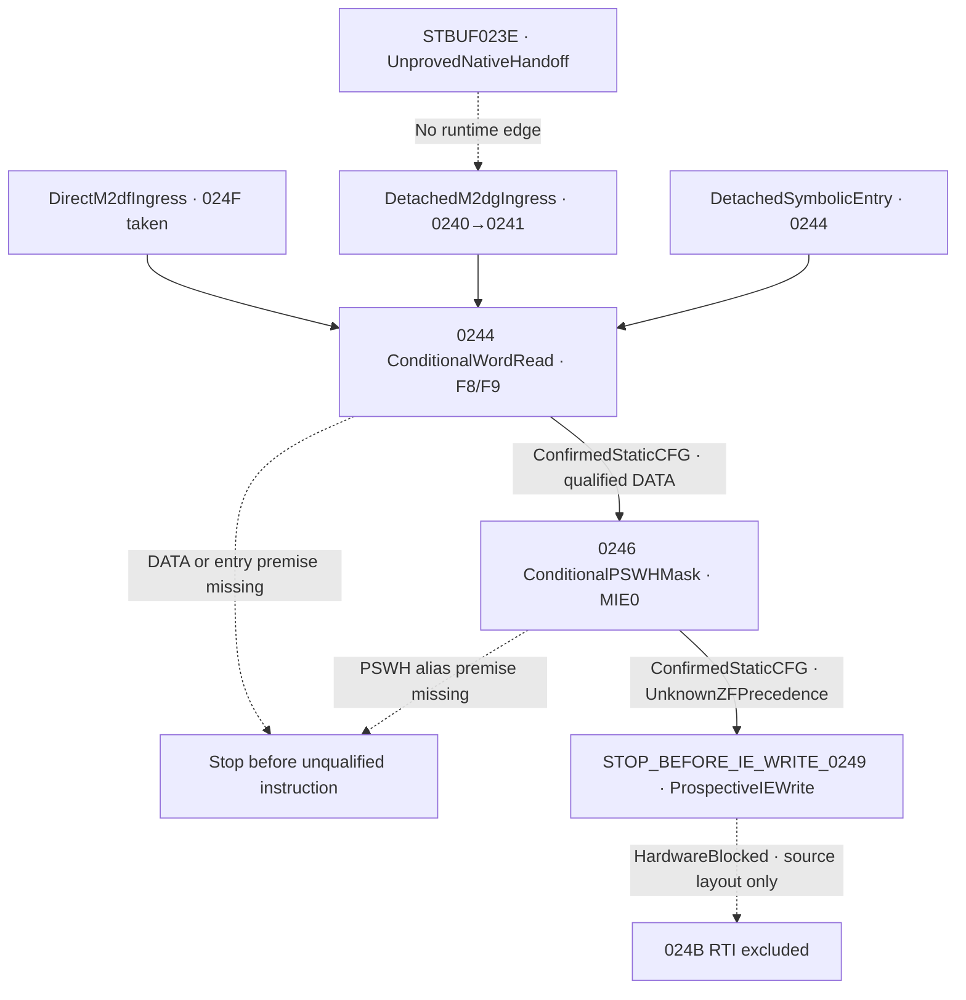

# M2dh detached epilogue, shadow provenance and IE boundary

## Accepted M2dg and new scope

M2dh starts from M2dg `b20f1341219888afd72b950e4a592e18b0e3f02a`.
M2dg qualified the detached `0240 → 0241 → 0244` prefix and kept it
separate from the direct M2df `024F → 0244` route. Both stopped before the
word load. M2dh models the following two instructions and the prospective
IE operand. It preserves the frozen M2cq `0295` model and its distinct
entry assumptions. [Accepted M2dg source](M2DG_DETACHED_POST_STBUF_0240_0241.md)
· [Accepted M2dg CI](https://github.com/Pvitaly91/HondaEcu/actions/runs/42520523953)

## Instruction inventory and local CFG

The redacted source inventory binds the reviewed instruction starts,
extents and operand roles. The opcode verification and original byte
identity are retained privately. ISA references are the printed pages of
the September 1991 OKI MSM66201 Instruction Manual.
[Redacted inventory](../research/p28-word0196/detached_epilogue_f8_pswh/source_inventory.json)

| PC | Form | Length | End exclusive | Role |
| --- | --- | ---: | --- | --- |
| `0244` | `L A,N8`, direct-zero-page word, ISA 3-69 | 2 | `0246` | Conditional DATA00F8/00F9 read into A, DD1 and word ZF |
| `0246` | `ANDB PSWH,#N8`, mask FE, ISA 3-27 | 3 | `0249` | Conditional PSWH register write, MIE0 and unresolved implicit flags |
| `0249` | `ST A,N8`, direct-zero-page word under DD1, ISA 3-154 | 2 | `024B` | Hard boundary before prospective IE001A/001B word store |
| `024B` | `RTI`, ISA 3-126 | 1 | `024C` | Excluded interrupt return. Extent does not imply fallthrough |



The active instructions have no conditional branches or PROGRAM operand
reads. A refusal at `0244` leaves A, DD and ZF unchanged. A refusal
at `0246` retains the qualified word read and its register effects.

## Two incoming histories

The frozen M2df direct path has `r5 != 2` and unsigned `r5 > r2`.
Its taken branch at `024F` reaches the pre-epilogue state without the
STBUF route. The frozen detached M2dg path reaches the same address
through the qualified DATA03F5 increment and DATA0356 bit set. The
adaptor verifies an exact frozen mathematical replay, including the
source identity, expected stop and completed steps. It carries the
original state, assumptions, register and memory generations, preceding
writes and unresolved obligations in a separate history. Neither path
obtains a native handoff or a hardware observation.

The projection takes the low and high bytes, their known bits and current
generations from the replay result. The caller can supply hypotheses about
candidate and intervening writers. Those hypotheses cannot replace replay
bytes or generations. The local comparison retains both paths and
reports the two separate effect results. A conditional equivalent effect
requires the same declared RAM model, known matching word and per-byte
generations, admitted shadow evidence, equal local effects and compatible
incoming flag knowledge. Contradictory flags, stale or overlapping
writers and missing generations prevent this equivalence. The proof
does not assert a shared temporal history.

## DATA00F8/00F9 and the word load

`N8` names a direct zero-page address. The read is a single 16-bit
DATA operand with F8 as the low byte and F9 as the high byte. LRB, SCB,
USP and SSP do not determine these addresses. Both nominal MSM66201 and
MSM66207 RAM maps include these slots. The model requires an explicit
conditional ordinary RAM and no-interference premise. Actual ECU
mapping, alternate aliases and stack or frame overlap remain unresolved.
The supplied pair is a software shadow. Hardware IE is a different
destination.

`0244` sets AL from F8, AH from F9 and DD to 1. It preserves CF and
HC. A known 1 in either byte proves ZF0. Sixteen known zeros prove ZF1.
All other incomplete cases leave ZF unknown. Derived partial A knowledge
retains each bit's original half and significance. A complete numeric A
is available only once both halves are known. The read records both
current generation tags. It creates no DATA store.

## Shadow producer and generation qualification

The bounded historical inventory is `2569 → 0000` (initial clear),
`3F16 → 2BAB` (mode A), `3F2A → A9A3` (mode B), and
`54E5 → 2BAB` (initial pair). These are reviewed software writer
sites. Equal values at `3F16` and `54E5` cannot identify the
last writer. The previous `2566 → 2569` relation belongs to its own
bounded startup corridor. A qualified read at `5CC9`, `0295`
or `0244` does not transfer current ownership among readers.
[Historical writer contract](../research/p28-word0196/indexed_suffix_ie_provenance/provenance.py)
· [M2ce bounded startup lineage](M2CE_ROOTED_SSP047E_FIRST_RAMTEST_PROVENANCE.md)

F8 and F9 carry separate byte-generation identities. A matching named
word producer requires both byte tags, matching bytes and no relevant
intervening write. The explicit event list keeps overlapping aligned word
writes, unknown footprints and same-value stores. A same-value store can
still break a proposed reaching definition. Distinct tags allow a
conditional mathematical read and cannot establish a single atomic
producer generation. A missing tag can support a value-only computation
under the declared memory premise and leaves producer provenance
unresolved. Potential indirect, local-bank, USP-relative and stack
frame overlaps remain possible outside the declared event and mapping
scope. No native or hardware owner is established.

## PSWH mask and flag precedence

`0246` uses the PSWH register alias and the immediate mask FE.
The mathematical candidate is `oldPSWH & FE`. Bit 0 is MIE and
its clear is a proved local effect under the explicit alias premise.
DD and unrelated PSW bits remain as established. AL, AH, LRB, SCB,
pointing registers, USP and SSP have no write in this instruction.

The generic ANDB table lists ZF as affected but gives no ordering between
the PSWH destination write and the ZF update inside that same byte.
The candidate byte therefore cannot supply final ZF. Printed page 32
of the retained incomplete MSM66201/207 user manual gives the more
specific warning that CF, HC and ZF are undefined when logical operations
target PSWH. Figure 3-5 on printed page 31 locates MIE. Device
applicability is unresolved. The conservative result marks all three
final flags unknown, while recording the generic masked byte and its
known bits separately. This broader gap applies at `0246`. The
qualified word read at `0244` still preserves CF/HC and derives ZF.

The result records one PSWH alias read and one ordered REGISTER
mask write. It keeps the known bits, writer generations and mask
candidate. The event remains even if MIE was already 0. This is a
symbolic register effect. The physical interrupt state, NMI and request
delivery remain unknown.

## IE boundary, excluded RTI and the M2cq parallel

At `0249` the conditional intent has DATA destination 001A/001B,
width 16, DD1 and an A source tagged with the F8/F9 and accumulator
generations. The prospective value retains partial knowledge. The model
creates no DATA001A/001B write, writer generation, IE readback, pending
request, or IRQ delivery. Existing source readings for IE polarity
remain unresolved. The prior device review preserves the set-one reading
from printed pages 165, 168 and 169 and the conflicting zero condition
from page 167 as separate hypotheses. The source extent of `024B`
supplies no matching frame identity. The model excludes RTI, SSP
progression, frame pop and native return.
[Prior IE source review](M2CX_INDEXED_SUFFIX_IE_PROVENANCE.md)

`0295 L A,00F8` and `0297 ANDB PSWH,#FE` are the accepted M2cq
analogs. The mathematical primitives have the same local roles under
qualified premises. The paths, generation lineages and preceding
writes differ. M2cq has its own conditional IE store at `029A`,
while M2dh stops before `0249`. M2dh does not reinterpret the frozen
M2cq flags or inherit permission to model its IE store.
[M2cq tail contract](M2CQ_PAYLOAD_CONSUMER_TAIL_RECONSTRUCTION.md)

## Portable model and independent checks

| Pure interface | Result |
| --- | --- |
| `detached_epilogue_0244_0246` | Qualified read, generation analysis, PSWH mask and prospective IE intent or a retained failure prefix |
| `epilogue_ingress_adapter` | Exact source replay and a detached entry snapshot with separate history |
| `compare_epilogue_ingresses` | Distinct lane results and a conditional local effect relation |

```text
require detached entry and conditional DATA qualification
record word read from the F8/F9 byte pair with both generation tags
set A halves and known bits from the corresponding bytes
set DD to one and derive word-zero consensus
retain that prefix if the PSWH alias premise fails
record the old PSWH and its candidate AND FE mask
clear MIE and leave unresolved implicit flags unknown
return the A-derived IE intent at stop-before 0249
```

The independent reference oracle derives the word order, zero predicate,
register mask and separate ingress effects before the first implementation
comparison. Domain and negative controls cover partial bytes, stale or
missing generations, competing same-value stores, invalid entry and alias
premises, and attempts to promote the intent to an IE/RTI or hardware
effect. All canonical fields, including refusals and history, participate
in the complete decompressed comparison through EOF for the frozen
expected, local, Ubuntu and Windows streams.

The finite source guard selects research QA only for the reviewed
overlay. Unrecognized source or workflow changes retain the historical
full QA fallback. The preservation audit verifies protected source and
evidence identities and accounts for the documented inherited
exceptions. Privacy checks cover source, logs and canonical artifacts.
Public records contain redacted forms, equations and invented fixtures.
Raw original ROM, private decoded evidence and credentials remain
outside Git and CI. Actual QA results and the evidence seal are recorded
in the private delivery report.

## Remaining blockers and a bounded M2di candidate

Current native shadow producer, alias/frame safety, actual device map,
PSWH flag applicability, IE polarity, pending requests and native
return remain unresolved. `EXECUTION_BLOCKED`, `FirmwareReady=false`,
`STOP_BEFORE_STBUF_023E` and `STOP_BEFORE_STBUF_2995` remain in force.

A separate M2di target is the frozen mode-zero edge `021F → 029D`.
Inventory the new corridor and qualify its first software predicate
using an explicit symbolic status premise, with a hard stop before
unqualified peripheral accesses such as the later SRBUF operand at
`02AE`. This scope can add parser coverage without requiring native
STBUF, IE, RTI, a C8 decision or device identity.
[Prior mode-zero frontier](M2CH_IRQ0213_FRAME_FOUR_INVOCATIONS.md)
