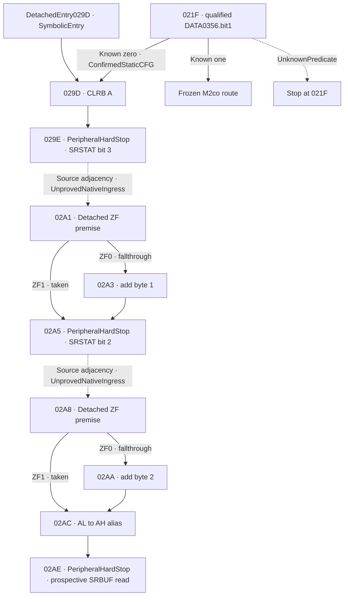

# M2di — conditional mode-zero parser corridor

## Accepted baseline and novelty

The accepted M2dh base is `f11547578e604b8d3df6b10e0835b284e6d09406`.
M2dh covers a separate F8/F9 and PSWH epilogue and ends before its IE store.
[Accepted M2dh source model](M2DH_DETACHED_EPILOGUE_F8_PSWH_IE_BOUNDARY.md) ·
[M2dh exact-SHA CI](https://github.com/Pvitaly91/HondaEcu/actions/runs/42525697299)

| Earlier scope | Retained source result | New M2di scope |
| --- | --- | --- |
| M2cn and M2co | The mode test at 021F has a taken edge to 029D. The frozen parser stops at this edge | Verify and preserve the frozen handoff, then model the first local effect |
| M2ch | Mode-zero path inventory identifies separate status 0056 and a candidate SRBUF read at 02AE | Verify exact extents, operands, edge predicates, and the earliest hardware barriers |
| M2df, M2dg, M2dh | Separate response, status, and epilogue scopes | Establish detached mode-zero arithmetic and AH alias effects with their own input provenance |
| M2ci, M2cj, M2ck | Conditional receive documentation and unresolved hardware ownership and acknowledgment | Retain the documented SRBUF identity and stop before any unqualified peripheral access |

## Entry from the frozen status test

`021F JBR off N8.1,rel8` is a three-byte instruction. Its following PC
is 0222. The signed displacement is +0x7B, giving target 029D. With the
frozen LRB007E premise, the off-page operand selects `DATA0356.bit1`
through the current page 0300.

- Known bit 1 equal to zero selects `ConfirmedEntryFrom021F` at 029D.
  The frozen prefix contains a single functional status read and the
  source branch edge. Its state and generations carry forward unchanged.
- Known bit 1 equal to one preserves the exact frozen M2co result.
- An unknown bit 1 yields `IndeterminateBranchAt021F` with no successor.
  Unknown bit 6 is compatible with a known-zero bit 1.

The adapter requires the current DATA0356 generation, checks it against
the supplied status identity, and qualifies its DATA mapping under the
conditional standard 207 internal map. The same address lies beyond the
standard 201 internal range. Actual ECU mapping and the native reaching
writer remain unresolved. The taken branch preserves the status byte
and its generation. Its exact edge excludes RMW 0222, the check at
0225, and dispatch 0255. A source branch contributes no fabricated
register or memory generation.
[Frozen M2co status and dispatch](M2CO_LENGTH_CHECKSUM_DATAFLOW_RECONSTRUCTION.md)

## Instruction extents and bounded CFG

Admitted ROM, retained listing and decoded extents, and the primary OKI
ISA qualify the following source inventory. Lengths below are bytes.
The peripheral instructions are identified at their source sites as
barriers or prospective obligations.
[Redacted source inventory](../research/p28-word0196/mode_zero_parser_corridor/source_inventory.json)

| PC | Form | Length | Source effect and successor |
| --- | --- | ---: | --- |
| 029D | `CLRB A` | 1 | `AL=0`, `DD=0`, `ZF=1`. Retains AH, CF and HC. Next 029E |
| 029E | `RB N8.3` | 3 | RMW of zero-page SRSTAT0056 bit 3 would feed 02A1. First hardware barrier |
| 02A1 | `JEQ rel8` | 2 | ZF1 takes 02A5. ZF0 falls through to 02A3 |
| 02A3 | `ADDB A,#N8` | 2 | Adds 1 to AL under DD0. Next 02A5 |
| 02A5 | `RB N8.2` | 3 | RMW of zero-page SRSTAT0056 bit 2 would feed 02A8. Separate hardware barrier |
| 02A8 | `JEQ rel8` | 2 | ZF1 takes 02AC. ZF0 falls through to 02AA |
| 02AA | `ADDB A,#N8` | 2 | Adds 2 to AL under DD0. Next 02AC |
| 02AC | `STB A,N8` | 2 | DD0 byte transfer from AL to the architectural AH alias DATA0007. Next 02AE |
| 02AE | `LB A,N8` | 2 | Identified byte load from zero-page SRBUF0055 into AL. Stop before its read |



The first downstream software predicate is JEQ at 02A1. It tests the
ZF that the preceding RB would derive from the old SRSTAT bit 3.
The next JEQ at 02A8 analogously depends on old bit 2. Each
`DetachedPostRbEntry` supplies a `statusHypothesis` with the exact
predecessor PC, old bit and its generation. Incoming ZF has its own
generation and must equal one minus that bit. An unknown value or missing
generation withholds the successor. The pending hardware steps at 029E
and 02A5 separate these scopes. ZF from CLRB at 029D or from the ordinary
0222 route supplies no qualified input for these detached predicates.

## Register, DATA, and generation effects

`DetachedEntry029D` is a mathematical entry with its own state and
premises. `ConfirmedEntryFrom021F` additionally carries the exact frozen
status path and generation. CLRB needs neither a local bank nor a
pointing-bank selection. Its accumulator and flag outputs are independent
of the incoming AL, DD, and ZF. AH, CF, HC, and the other supplied state
are retained with their evidence.

The suffix arithmetic requires DD0 and a declared AL generation. For an
admitted fallthrough adding `k` to AL, the result is `(AL + k) mod 256`, CF
comes from the byte carry, HC comes from the low-nibble carry, and ZF
tests the result. Incomplete operand knowledge is evaluated conservatively.
An unknown byte or bit stays unknown unless all admitted values establish
the same result or bit. The taken paths retain the accumulator, its
generations, and its flags through the JEQ.

Zero-page operands have no LRB/SCB dependency. The byte transfer at
02AC uses the architectural AH alias. It reads the source AL, retains
the neighboring AL byte and the applicable flags, and contributes one
ordered AH write with the old and new generations. Equal byte values
still produce distinct write evidence. There is no synthetic read of AH
for bookkeeping. There are no PROGRAM operand accesses in the admitted
software effects. The architectural alias is kept separate from ordinary
DATA, and the peripheral obligations are kept separate from both.

### Portable algorithm

```text
require qualified 0356 status generation and nominal DATA premise
prefix = frozen_m2co_parser(snapshot)
if bit1 unknown: stop at 021F with frozen prefix
if bit1 known set: retain exact frozen result
require exact 021F taken edge and unchanged prefix state

// detached 029D is also admitted with independent typed state
AL = 0
DD = 0
ZF = 1
stop before SRSTAT read-modify-write at 029E

// separate symbolic entry after an independently declared old-status bit
require matching symbolic old bit and ZF
if ZF unknown: retain prefix and stop before successor selection
if fallthrough: apply modulo-byte add with CF, ZF, and HC
if entry == 02A1: stop before separate SRSTAT read-modify-write at 02A5
qualify DD0 and AL/AH alias generations
AH = AL                     // one ordered architectural byte write
stop before SRBUF read at 02AE
```

## Peripheral boundaries and unresolved hardware

The ordinary status source DATA0356 and the direct zero-page SRSTAT0056
are distinct operands. Both RB source sites are unqualified peripheral
RMWs even though SRSTAT is documented as a readable/writable byte.
The composed path therefore ends at
`STOP_BEFORE_UNQUALIFIED_SRSTAT_RMW_029E`. The independently qualified
first suffix ends before its own 02A5 SRSTAT RMW.

The admitted form at 02AE identifies a byte load from standard receive
buffer DATA0055, a documented read-only register. If a detached suffix
establishes the preceding alias write, the applicable boundary is
`STOP_BEFORE_UNQUALIFIED_SRBUF_READ_02AE`. The main path still stops at
029E. The load would select AL and DD0 with a byte-zero ZF result under
qualified ordinary LB semantics. The source provides no actual receive
byte or buffer owner, and the model performs no such read. PC 02AE and
the historical foreground PC 28AE are distinct source identities.

RX READY request, current IE/MIE and pending state, serial filtering,
overrun replacement, read-to-clear behavior, ACK, reassertion, collision
ordering, native frame and SSP remain separate hardware questions.
Documentary R/W access class and read-only buffer class establish
neither hardware observation nor an interrupt lifecycle. A synthetic
software value carries only the evidence of its own symbolic premise.
[RX READY and SRBUF obligations](M2CK_RXREADY_ACKNOWLEDGEMENT_REASSERTION.md)

## Verification and next source scope

The pure interfaces are `mode_zero_parser_step` for frozen-parser
composition, `mode_zero_corridor_029d` for detached 029D, and
`mode_zero_detached_suffix` for independently qualified suffix effects. The independent
oracle calculates the full expected record before model comparison.
Domain and negative controls exercise the three-valued status predicate,
exact taken and fallthrough edges, partial bytes, byte carry and half
carry, generation mismatch, alias writes, and the first applicable
hardware boundary. The deterministic stream retains refused and
indeterminate records. Delivery requires complete decompressed byte
equality with the oracle locally and on Ubuntu and Windows, plus an
exact source-binding check and finite research-only CI routing.

The private delivery evidence records actual QA and preservation
results. Privacy checks cover the public source diff, logs, and canonical
artifacts. The inventory exposes source forms, equations, and approved
identities. ROM, raw listing and operand payloads remain in the private
evidence scope. Historical fingerprints and the preservation exception
ledger retain their prior identities.

A separate M2dj candidate is a detached audit of 02B0 and 02B1 under
explicit symbolic A and pointing-bank premises. M2ch inventories the
possible DP write, and M2cq inventories a later possible 02B7 alias.
Source-qualifying the DP store/load and 02B2 predicate can add new local
coverage. Stop at the first unqualified predicate, indirect operand,
or other source boundary. This scope requires no SRBUF transaction or
native ingress.

`EXECUTION_BLOCKED`, `FirmwareReady=false`, and the inherited
`STOP_BEFORE_STBUF_2995` remain in force.
