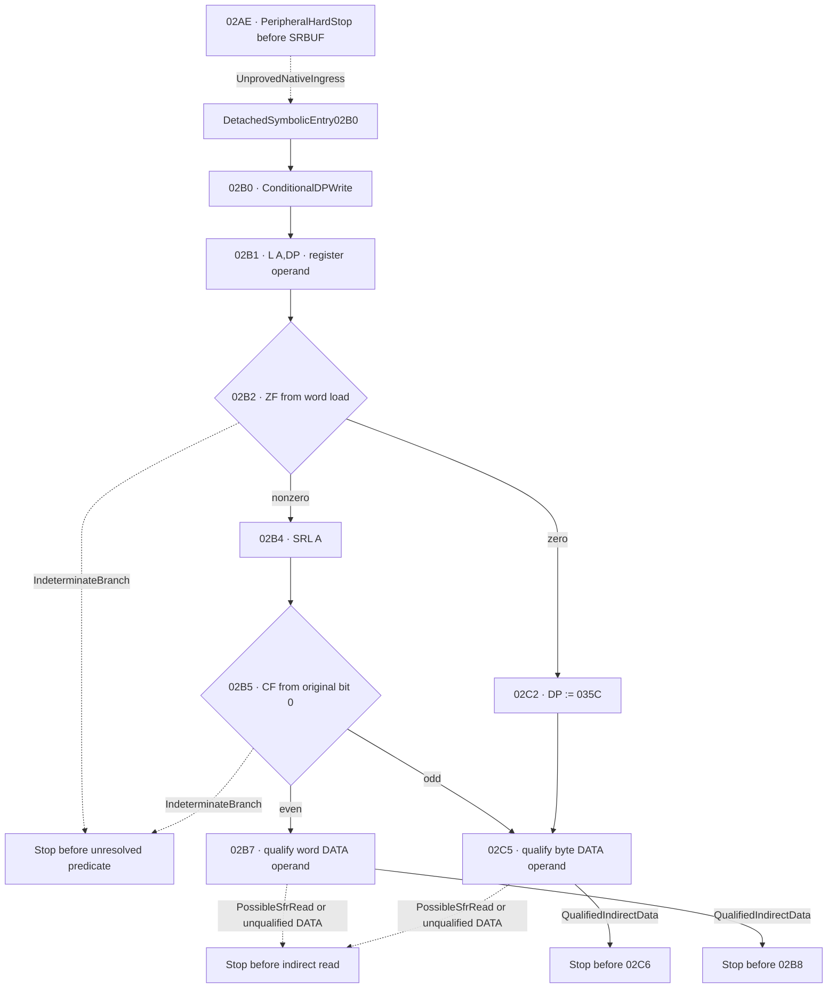

# M2dj — Detached DP parser continuation

## Accepted base and novelty

The accepted M2di base is `eecf88fc8b1aa4a6221204c72a9c25082ad004c9`.
Its mode-zero reconstruction stops at SRSTAT on the composed path. Its
separate suffix reaches the boundary before the SRBUF read at `02AE`.
[M2di source model](M2DI_MODE_ZERO_PARSER_CORRIDOR.md) ·
[M2di exact-SHA CI](https://github.com/Pvitaly91/HondaEcu/actions/runs/42692238402)

| Previous evidence | Reused condition | New M2dj scope |
| --- | --- | --- |
| M2di `02AC` and `02AE` | `AH ← AL` is a conditional prior suffix effect. The SRBUF operation at `02AE` is blocked. | An independently supplied A16 and state at `02B0`. |
| M2aw architecture | Little-endian A halves, the selected pointing-bank alias and even word addressing. | Apply these rules at the exact DP store, register load and indirect operands. |
| M2ch writer inventory | The earlier static inventory names possible DP writes in this region. | Verify instruction extents, ordered writes and predicate provenance. |
| M2cq alias inventory | `02B7` is a candidate reader of `03F4/03F5` under a specific DP address. | Qualify the indirect address and current per-byte generations in the detached state. |
| M2df alternate response | PROGRAM and DATA are separate. | This corridor has no PROGRAM-table operand or table lookup. |

[M2aw architecture](M2AW_NX8_200_TARGET_ABI_CONTRACT.md) ·
[M2ch inventory](M2CH_IRQ0213_FRAME_FOUR_INVOCATIONS.md) ·
[M2cq alias scope](M2CQ_PAYLOAD_CONSUMER_TAIL_RECONSTRUCTION.md) ·
[M2df PROGRAM/DATA scope](M2DF_ALTERNATE_PARSER_RESPONSE_CHECKSUM.md)

## Exact source corridor and entry

The admitted ROM, retained listing, decoded extents and primary OKI
instruction manual establish the following bounded source layout. The
public inventory records instruction forms and source relationships.
[Redacted source inventory](../research/p28-word0196/detached_dp_parser_continuation/source_inventory.json)

| PC | Form | Length | Source role |
| --- | --- | ---: | --- |
| `02AE` | `LB A,N8` | 2 | Inherited barrier before `DATA0055` SRBUF. Encoded successor is `02B0`. |
| `02B0` | `MOV DP,A` | 1 | DD-independent word write of A16 to the selected DP backing pair. |
| `02B1` | `L A,DP` | 1 | Load the DP register word into A, set DD1 and derive ZF for either incoming DD. |
| `02B2` | `JEQ rel8` | 2 | Taken to `02C2` if `02B1` established ZF1. Fallthrough to `02B4`. |
| `02B4` | `SRL A` | 1 | DD1 word shift. CF derives from the original low bit. DP retains the original word. |
| `02B5` | `JLT rel8` | 2 | CF1 takes a nonzero odd pointer to `02C5`. CF0 sends a nonzero even pointer to `02B7`. |
| `02B7` | `L A,[DP]` | 1 | Conditional word read. Stop here if the operand is unqualified. |
| `02B8` | `LB A,N8` | 2 | Boundary before the next source effect. The identified operand is the AL alias `DATA0006`. |
| `02C2` | `MOV DP,#N16` | 3 | The zero route writes the source literal `035C` to the selected DP pair. |
| `02C5` | `LB A,[DP]` | 1 | Conditional byte read. Stop here if the operand is unqualified. |
| `02C6` | `SJ rel8` | 2 | Boundary before the next source effect. Its static destination is `02BE`. |

The OKI September 1991 Instruction Manual gives the word and byte load
rules in sections 3-69 and 3-70, JEQ and JLT in 3-66/67, MOV forms in
3-82/85/86, and SRL in 3-150. Address geometry comes from 1-17 through
1-20 and the standard bank layout in E2E1027-27-Y4 pages 9, 13 and 17.

`STOP_BEFORE_UNQUALIFIED_SRBUF_READ_02AE` remains in force. The prospective
byte load would write the received byte to AL, set DD0 and determine ZF
from that byte while retaining AH, CF and HC. The model begins with
`DetachedSymbolicEntry02B0`. Its typed A16, AL/AH and register knowledge
must agree. An omitted half and an unknown flag retain their uncertainty.
The model creates no `02AE` read or generation and assumes no provenance
from the earlier `AH ← AL` effect.

## Selected DP and generation provenance

The reviewed pointing bank has `base = 0080 + 8 × SCB`. X1, X2, DP and USP
start at offsets 0, 2, 4 and 6. Consequently DP's low and high DATA bytes
are at `0084 + 8 × SCB` and the next address. A write changes that pair
in the same symbolic DATA map used by later register and indirect reads.
Unknown SCB leaves the selected pair unresolved, even if hypothetical
banks would have equal numerical values.

AL and AH supply the low and high halves of A16. The entry rejects
contradictory overlapping views. A partial word retains its known bits.
The MOV instructions preserve A, DD and all flags.
The DP write journal retains the source generation, previous and new
backing-byte generations, selected bank and ordered write. An equal
value still records the write with new provenance. Observing the old
value for the journal adds no functional destination read.

`02B1` reads the selected DP word itself. It does not read the DATA
address represented by that word. Its full-word zero test yields 0
when any bit is known one, 1 when all sixteen bits are known zero,
and unknown otherwise. The predicate at `02B2` uses that ZF generation,
independent of incoming ZF, CF or any unperformed SRBUF load. Unknown
predicate retains the completed prefix with no selected successor.

On the nonzero branch, `02B4` uses the word descriptor established by
the load and retains ZF, HC and DD. The parity test uses CF from the
shift and leaves DP intact. Its branch relation comes from the carry
flag, independent of a signed comparison.
`02B7` is the word-load route. Its successful load sets DD1 and
computes ZF from the word. `02C5` loads AL and sets DD0 and byte ZF,
retaining the preceding AH. These loads retain CF and HC. The bounded
effects do not use X1, X2, USP or SSP. LRB is relevant only to whether
an addressed byte has a named local alias.



## Indirect DATA applicability

`02B7` masks off the DP low bit before addressing a little-endian word.
The pair for raw `FFFF` is `FFFE/FFFF`. It does not wrap. For `02C5`
the byte address is exactly the DP value, including odd addresses. A
word effective address can be known when the only unknown raw pointer
bit is bit 0. The same uncertainty prevents a precise byte address.
Instruction PCs belong to PROGRAM space. These operand addresses belong
to DATA space.

Both standard maps start internal RAM at `0080`. The MSM66201 interval
ends at `027F` and MSM66207 ends at `047F`. `035C` is outside the first
interval and inside the second. The model requires a named conditional
map and explicit no-interference premise. The standard ranges do not
establish the target's physical RAM decode or external RAM applicability.
[Accepted nominal memory maps](M2CL_ACTUAL_ECU_SILICON_APPLICABILITY.md)

Each addressed byte gets its own obligation. A word including write-only
STBUF `0051`, the unresolved SRBUF read `0055`, another SFR or reserved
address, or an unqualified low architectural alias stops before the
whole read. The model recognizes pointing-bank slots and the named
F8/F9 and FA/FB shadow locations. For allowed reads it uses their same
shared backing bytes and current generations. These names do not bind a
native producer. An unknown LRB leaves the local-alias label unknown.

For either indirect operand, the current DP byte generations must match
the expected pair. The supplied intervening write list retains every
event. Unknown addresses and writes overlapping the DP pair block
qualification. Once a target address is resolved, writes overlapping
that target also block the read. Word event footprints align even,
including an event declared at an odd raw address. Equal value or
matching generation labels do not make an overlapping event harmless.

Qualified mathematical reads carry ordered source byte generations,
values and individual known bits. An explicitly unknown value can retain
partial knowledge when its symbolic slot and generation exist. Missing
slots or missing generations stop before the access. Exact first stops
include an unqualified entry or bank, the unresolved branch, and
`STOP_BEFORE_UNQUALIFIED_INDIRECT_DATA_READ_02B7` or
`STOP_BEFORE_UNQUALIFIED_INDIRECT_DATA_READ_02C5`. Successful reads
end at `STOP_BEFORE_UNREVIEWED_02B8` or `STOP_BEFORE_UNREVIEWED_02C6`.

## Candidate local alias at 02B7

If the qualified word target is `03F4/03F5` and LRB is `007E`, the two
bytes alias r4 and r5. The range is nominal internal RAM only under
the standard MSM66207 profile. The read reports the two supplied
current generations and the local alias relationship. The M2cq writer
at `026C` is a historical candidate. Its generation does not become
the current owner merely because an address or byte value agrees.
Other frame and stack interference remains unresolved for real hardware.

## Pure transformations and portable equivalent

`detached_02b0_02b2_transform` produces the exact modeled prefix,
records the two generation-aware branches and extends through a
qualified indirect read. `indirect_data_address_qualification` checks
the selected pointer, nominal memory applicability and read lineage
without applying the accumulator load.

```text
qualify symbolic entry, A16 knowledge and selected SCB
write selected DP backing bytes from A16
A16 := selected DP word
DD := 1
ZF := zero_consensus(A16)
require known ZF for 02B2
if ZF:
    write selected DP backing bytes from literal 035C
    qualify and load one DATA byte at 02C5
else:
    CF := original A16 bit 0
    A16 := logical_right_shift(A16, 1)
    require known CF for 02B5
    if CF:
        qualify and load one DATA byte at 02C5
    else:
        qualify and load one even-aligned DATA word at 02B7
stop before first unqualified operand or unreviewed successor
```

## Oracle, verification and preservation

An independent reference derives expected records from the primary
source equations. It is frozen before any comparison with the
implementation. Domain tests cover zero, even and odd routes, unknown
predicates, partial accumulators, the selected bank and same-value
generations, the 201/207 range distinction, odd byte addressing, even
word alignment, the high address boundary, both-byte SFR qualification
and the M2cq alias case. Negative controls reject conflicting register
views, stale and missing generations, overlapping writes, invalid
widths or spaces, and fabricated receive or execution authority.

The comparison gate requires the complete decompressed streams
from the reference, local run, Ubuntu and Windows to agree byte
for byte. The finite research lane preserves the historical QA fallback.
Privacy checks cover the public diff, logs and CI artifacts. Public
records retain forms, mathematical effects and approved identities.
The original payload, decoded raw operands and retained listing remain
private. Source and preservation audits use the accepted bindings and
document existing exceptions separately.

## Remaining limits and next source candidate

Actual SRBUF ownership and acceptance, RX READY and ACK, the
physical MCU and memory map, pending IRQ, actual frame and native
ingress are unestablished. `EXECUTION_BLOCKED`, `FirmwareReady=false`
and `STOP_BEFORE_STBUF_2995` remain in force.

A separate M2dk candidate is the `02B8` AL self-alias load and `02BA`
current-page status update, together with the distinct control edge
from `02C6`. Verify the aliases, LRB and reaching generations from
explicit symbolic inputs, then stop before the prospective STBUF
effect at `02BE`. No receive event or native handoff is needed for
that scope.
